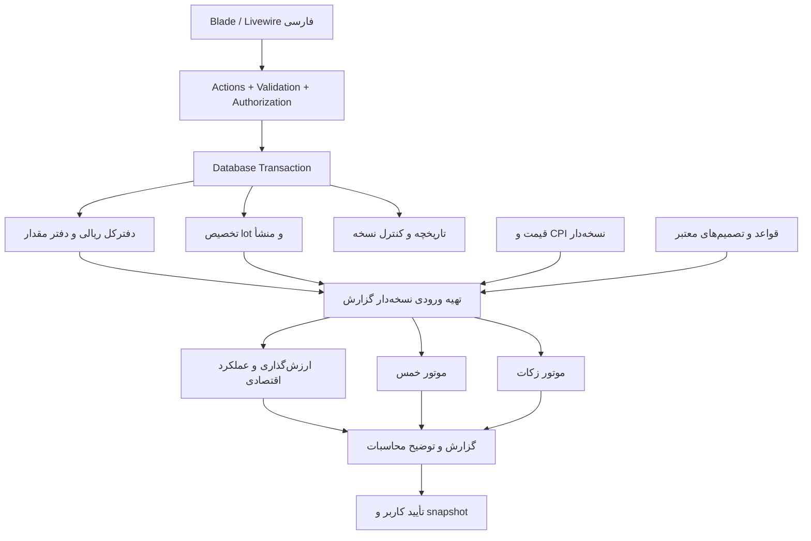

# معماری پیشنهادی

نسخه 0.1 — 2026-10-12 — منتظر تأیید. مدل جزئیات در [DATABASE](DATABASE.md) و قراردادهای عددی در [FINANCIAL_RULES](FINANCIAL_RULES.md).

## ساختار

یک برنامه یکپارچه Laravel با پایگاه رابطه‌ای. Eloquent برای persistence، Action برای هر مورد استفاده و سرویس خالص برای محاسبات. Repository عمومی، bus اختصاصی، microservice و event sourcing کامل لازم نیست. سند مالی ثبت‌شده و سوابق مبنا تغییرناپذیرند؛ projectionها مشتق و قابل بازسازی‌اند.



ساختار پیشنهادی برای شروع پیاده‌سازی، نه فایل‌های ایجادشده:

```text
app/
  Actions/{Finance,Assets,Periods,Backup}/
  Services/{Ledger,Provenance,Valuation,Performance,Khums,Zakat,Calendar}/
  Data/                  DTOهای ورودی و نتیجه
  ValueObjects/          MoneyRial, Quantity, ExactRatio, PeriodRange
  Enums/
  Models/
  Livewire/              state فرم، فراخوانی Action، نمایش نتیجه
  Policies/
  Console/Commands/
  Support/               adapter عدد دقیق و تقویم
resources/views/         صفحات و اجزای نمایشی
tests/{Unit,Feature,Integration}/
```

پوشه‌ها هنگام نیاز ایجاد می‌شوند. موتورهای Khums/Zakat به Livewire، HTTP، زمان سیستم یا query مستقیم وابسته نیستند. DTO کامل می‌گیرند و نتیجه قطعی نسبت به همان ورودی و نسخه قاعده می‌دهند. Clock تزریق می‌شود؛ SQL و I/O در آماده‌سازی ورودی است. `CalculationResult` شامل amounts، status، issues و trace است؛ null با صفر فرق دارد.

## مسیر ثبت یک عملیات

1. فرم یک intent شامل نوع، زمان، حساب‌ها، مبلغ/مقدار، کارمزد و `idempotency_key` می‌سازد. مبلغ و مقدار در Livewire رشته هستند.
2. Action احراز هویت، مجوز، داده‌ها، دوره، واحدها و قصد/منشأ موردنیاز را در سمت سرور بررسی می‌کند. محاسبات ارسالی مرورگر قابل اعتماد نیستند.
3. تراکنش DB و قفل نویسنده گرفته می‌شود؛ نسخه داده از نو خوانده می‌شود. مانده کافی و عدم مصرف دوباره lot کنترل می‌شود.
4. سند متوازن، ردیف‌های مقدار، تخصیص منابع/بها و audit با هم ثبت می‌شوند؛ شمارنده نسخه داده افزایش می‌یابد.
5. پس از commit نتیجه نمایش داده می‌شود. projection/cache می‌تواند بازسازی شود؛ صحت ثبت به job پس‌زمینه وابسته نیست.

تکرار کلید با payload یکسان همان نتیجه را برمی‌گرداند؛ با payload متفاوت خطای تعارض می‌دهد. تطبیق مبلغ/تاریخ مشابه فقط هشدار تکرار است، چون دو پرداخت یکسان ممکن است واقعی باشند.

## همزمانی و ثبت گذشته

تک‌کاربره به معنی تک‌درخواست نیست: دو تب، دوبار کلیک، فرمان محلی و تهیه گزارش همزمان‌اند. یک ردیف `dataset_state` با شماره نسخه برای قفل/مقایسه اتمیک همه نوشتن‌های مالی و مبنا استفاده می‌شود. در SQLite نوشتن قفل پیش از خواندن مانده با تراکنش write مناسب انجام می‌شود؛ `lockForUpdate` به‌تنهایی راه‌حل SQLite نیست. در MySQL/MariaDB قفل ردیفی همان قرارداد را پیاده می‌کند. adapter کوچک driver-specific با تست دو اتصال؛ retry محدود busy/deadlock با همان کلید عملیات.

ثبت با تاریخ گذشته در دوره باز، ترتیب `(effective_at, sequence)` را تغییر می‌دهد و ممکن است بهای فروش و منشأ بعدی را عوض کند. ابتدا replay از نقطه تغییر و پیش‌نمایش تفاوت؛ در صورت مانده منفی در هر نقطه رد شود. تخصیص‌های مشتق نسخه جدید می‌گیرند و قدیمی باقی می‌ماند. برای بازه بسته، نوشتن مستقیم رد می‌شود و فقط روند اصلاحیه مجاز است. اصلاح قیمت قدیمی سند مالی را عوض نمی‌کند، ولی گزارش‌های باز وابسته را stale می‌کند.

اگر replay بهای خروج یک فروش ثبت‌شده را تغییر دهد، تغییر صرف جدول تخصیص کافی نیست: مجموعه اصلاح باید سند متوازنِ تعدیل بهای دارایی/سود یا زیانِ همان فروش را نیز بسازد، با پیوند به فروش اصلی، تاریخ اثر مربوط و کلید یکتای `(amendment, affected_operation)`. مبلغ وجه واقعی فروش تغییر نمی‌کند. سند اصلی دست‌نخورده می‌ماند و گزارش مقدار تعدیل‌شده را از اصل به‌علاوه اصلاحات می‌خواند. commit عملیات گذشته، تخصیص‌ها و اصلاحات وابسته یک واحد اتمیک است؛ در صورت برخورد با دوره بسته، کل مسیر به اصلاحیه تأییدشده منتقل می‌شود.

## گزارش و snapshot

ورودی گزارش شامل دو زمان است: `as_of` (زمان مالی) و `knowledge_cutoff` (تا چه زمانِ ثبت اطلاعات). گزارش زنده گذشته می‌تواند از قیمت اصلاح‌شده امروز استفاده کند و این موضوع را نشان می‌دهد؛ گزارش بسته همیشه snapshot خودش را می‌خواند. شناسه رکورد و مقدار مصرف‌شده هر دو در snapshot هستند تا حذف/تغییر lookup اثری نگذارد.

فرایند محاسبه: خواندن snapshot سازگار داده + نسخه → محاسبه خارج تراکنش طولانی → ذخیره نتیجه با input hash. تأیید، دوباره نسخه/hash و مسائل مسدودکننده را در تراکنش قفل‌شده کنترل می‌کند. تغییر بین پیش‌نمایش و تأیید = نیاز به محاسبه و تأیید دوباره. قید یکتا از بستن دوباره جلوگیری می‌کند. تغییر در مقادیر نمایشی نامرتبط نیز می‌تواند محافظه‌کارانه پیش‌نویس را کهنه کند.

## سررسید بدون وابستگی به Cron

پس از ورود موفق و در بارگذاری داشبورد، سرویس سبک `DetectDuePeriods` بازه‌ها را بررسی می‌کند. برای هر سررسید گذشته یک درخواست پیش‌نویس یکتا ساخته می‌شود. محاسبه محلی می‌تواند همزمان اجرا شود؛ اگر طولانی شد، فرمان قابل اجرای محلی و وضعیت قابل ازسرگیری دارد. scheduler تنها محرک اضافی است. endpoint خواندنی عمومی هیچ کار مالی انجام نمی‌دهد؛ تولید خودکار پیش‌نویس تحت احراز هویت است و هرگز تأیید یا پرداخت نمی‌کند.

چند سال خاموشی: دوره‌ها به ترتیب زمانی ایجاد می‌شوند؛ داده و پایه سال قبلیِ تأییدنشده باعث برچسب وابستگی/موقت در سال بعد است. ثبت عملیات جدید مجاز می‌ماند، اما پایه مخمّس از پیش‌نویس سال قبل ساخته نمی‌شود.

## امنیت و نگهداری

- ایجاد مالک با فرمان محلی و ورودی مخفی رمز؛ ثبت‌نام و بازیابی عمومی ایمیلی تا نیاز واقعی نداریم. بازیابی دسترسی فرمان محلی کنترل‌شده دارد و sessionها را باطل می‌کند.
- hashing استاندارد Laravel، محدودسازی تلاش ورود، گردش session بعد ورود، CSRF، escape پیش‌فرض Blade، اعتبارسنجی فایل و مسیر؛ همه عملیات Livewire نیز authorization دارند.
- اجرا روی loopback در محلی؛ برای سرور HTTPS، cookie امن، `APP_DEBUG=false`، web root فقط `public` و اجازه فایل محدود. DB، رسیدها، خروجی‌ها و backup بیرون public هستند.
- ورودی مالی، رمز، شماره حساب کامل و snapshotها در log عمومی نوشته نمی‌شوند. audit محتوای لازم مالی را خصوصی نگه می‌دارد؛ مشاهده/دریافت خروجی نیز احراز هویت می‌خواهد.
- رمزگذاری کامل دیسک/محل نگهداری DB در سطح میزبان برای داده در حالت سکون پیشنهاد می‌شود. رمزگذاری داخلی Laravel به‌تنهایی DB SQLite را رمزگذاری نمی‌کند. backup رمزگذاری‌شده و کلید بازیابی جدا لازم است؛ کلید در Git/فایل خروجی عمومی قرار نمی‌گیرد.
- محتوای URL احکام در runtime خودکار fetch نمی‌شود؛ نسخه‌های تأییدشده آفلاین موجودند. واردکردن HTML منبع یا فایل مالی نباید اسکریپت اجرا کند.
- audit با actor/time/reason و پیوند اصلاحیه؛ hash snapshot برای تشخیص تغییر اتفاقی است و در برابر مالک سیستمِ قادر به تغییر DB و کد تضمین ضد‌دستکاری مطلق نیست.

## پشتیبان و بازیابی

پشتیبان: اتصال سازگار SQLite با Backup API یا روش رسمی معادل، فایل‌های خصوصی ثابت، manifest نسخه schema/برنامه، checksum و رمزگذاری با ابزار استاندارد. کپی صرف فایل DB در حین نوشتن/WAL ممنوع است. این انتخاب بر مبنای [مستند SQLite Backup](https://www.sqlite.org/backup.html) است.

قبل از مهاجرت schema و اصلاحیه مهم پشتیبان گرفته می‌شود؛ یادآوری روزانه در اولین اجرای روز و backup دستی وجود دارد. نگهداری پیشنهادی ۷ روزانه و ۴ هفتگی؛ حذف آخرین نسخه سالم ممنوع، مقصد دوم با انتخاب کاربر. خاموش بودن برنامه به معنی نبود backup آن روز است و UI باید صادق باشد.

بازیابی: بررسی رمز و checksum و نسخه → بازیابی در محل موقت → integrity و قیود و توازن/replay → پیش‌نمایش تعداد/بازه → backup از وضعیت فعلی → تأیید کاربر → جایگزینی اتمیک در حالت نگهداری و ابطال sessionها. واردکردن bundle مسیر دلخواه یا اجرای کد ندارد. بازیابی ناموفق داده جاری را تغییر نمی‌دهد. از snapshot رمزگذاری‌شده بدون کلید همراه استفاده نمی‌توان کرد؛ روند نگهداری کلید مستقل مستند می‌شود.

## وابستگی‌ها و سازگاری

بررسی در 2026-10-12: Laravel 13 از PHP 8.3 تا 8.5 پشتیبانی اعلام کرده است؛ PHP 8.4 هدف مناسبی برای درخواست فعلی است. [انتشار Laravel 13](https://github.com/laravel/docs/blob/13.x/releases.md)

Livewire 4 با Alpine همراه است؛ بارگذاری نسخه دوم Alpine ممنوع. Tailwind از مسیر Vite و assetهای محلی ساخته می‌شود. Pest نسخه سازگار هنگام نصب pin می‌شود؛ راهنمای ارتقای Laravel 13 نسخه ۴ Pest را پیشنهاد کرده است. [Livewire](https://livewire.laravel.com/docs/4.x/installation)، [Tailwind/Vite](https://tailwindcss.com/docs/installation/using-vite)، [Laravel upgrade](https://laravel.com/framework/docs/13.x/upgrade)، [Pest](https://pestphp.com/docs/installation)

یک کتابخانه محاسبه دقیق مانند `brick/math` پشت adapter و یک ابزار تقویم شمسی آزموده مجاز و توجیه‌پذیر است؛ انتخاب نهایی، مجوز و سازگاری قبل از نصب در فاز ۱ بررسی می‌شود. PDF/XLSX نیز بعد از آزمون فارسی و دقت عدد انتخاب می‌شوند؛ بسته صرفاً برای راحتی اضافه نمی‌شود. هیچ بسته‌ای در این فاز نصب نشده است.
