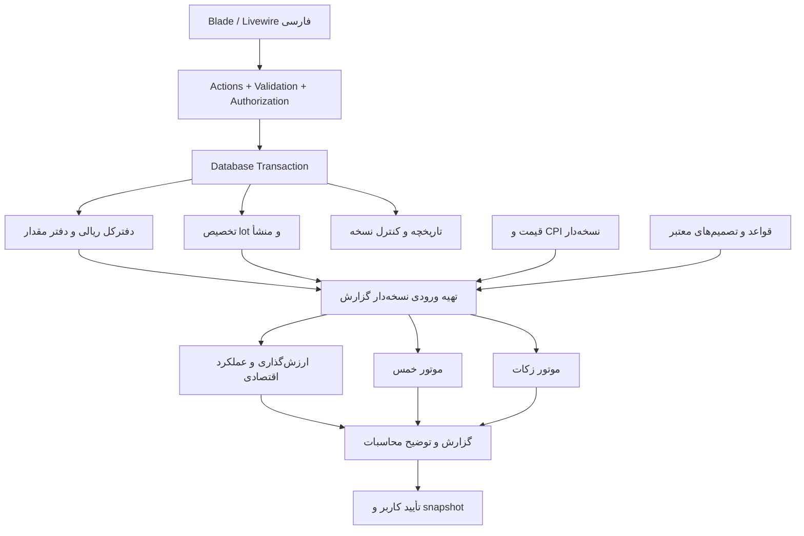

# معماری پروژه

## اجرای فاز ۳ — 2026-10-14

مسیر ریالی فعلی `Livewire → OpeningSetup/CashBook → DB transaction` است. Actionها `Gate` مالک را دوباره کنترل می‌کنند. نخستین نوشتن هر تراکنش، revision ردیف ثابت `financial_state` را تغییر می‌دهد تا نویسنده‌ها روی SQLite به‌ترتیب وارد شوند؛ کلید idempotency و hash payload پس از قفل بازبینی می‌شوند. operation و journal متوازن، projection حساب، provenance و audit یا همگی commit می‌شوند یا همگی rollback. مسیر `CashOverview` گزارش مانده/درآمد/هزینه را بدون موتور شرعی از داده ثبت‌شده می‌خواند.

در پول مخلوط، `protected_min/max` حدود هر حساب هستند؛ منشأ واقعی و اظهار قلم افتتاحیه در `provenance_events` و `user_decisions` حفظ می‌شود. این حدود جای تخصیص قطعی شرعی و `provenance_entries` نهایی فاز ۵ نیستند؛ خصوصاً حداکثر چند حساب پس از انتقال را نمی‌توان جمع کرد. عملیات تاریخ‌گذشته پیش از آخرین سند به‌جای replay ناقص رد می‌شود. برگشتِ آخرین عملیات سند تازه مرتبط است و مانده/حدود قبلی را بازمی‌گرداند. اصلاح غیرآخرین سند، دارایی مقداری و replay بعدی هنوز طراحی فازهای مربوط‌اند.

راه‌انداز فاز ۳ فقط تنظیمات اولیه و بانک/نقد/اصل بدهی‌وطلب ریالی را با ذخیره/ادامه و تأیید نسخه دیده‌شده پوشش می‌دهد. UI هشدار استفاده صرفاً با داده ساختگی دارد؛ تکمیل دارایی‌های مقداری و تأیید افتتاحیه واقعی به فازهای ۴–۵ وابسته است. **هیچ حساب جدید افتتاحیه بعد از تأیید دوباره ساخته نمی‌شود.**

## اجرای فاز ۲ — 2026-10-14

کلاس‌های خالص `app/Support/Numbers` و `app/Support/Dates` اکنون مرز عدد و تاریخ را پیاده می‌کنند. `brick/math` از dependency موجود Laravel استفاده می‌شود و `ext-intl` تقویم Persian را ارائه می‌کند. `MoneyRial` در خروجی/ورودی رشته و کران signed BIGINT است؛ مقدار دارایی `atoms` رشته‌ای تا ۷۸ رقم دارد. `EffectiveTime` برای ورودی روزانه UTC قطعی تولید نمی‌کند. این‌ها هنوز به رویداد مالی/دفترکل وصل نشده‌اند.

پشتیبان پایه در `app/Support/Backup/SqliteBackup.php` از `VACUUM INTO` برای snapshot سازگار پایگاه فعال، `ext-sodium` برای رمز جریان و hash/integrity/FK/schema برای تأیید استفاده می‌کند. snapshot موقت خصوصی با مجوز 0600 حذف می‌شود. بازیابی فقط به فایل تازه و خصوصی انجام می‌شود؛ DB فعال و نشست‌های آن تغییر نمی‌کنند. چرخه جایگزینی DB فعال، پیش‌نمایش محتوا، یادآوری/retention و انتقال نسخه‌های schema هنوز پیاده نشده و نباید به‌عنوان قابلیت آماده بهره‌برداری تلقی شوند. منبع فنی [SQLite VACUUM INTO](https://www.sqlite.org/lang_vacuum.html#vacuum_with_an_into_clause) سازگاری snapshot حین WAL را شرح می‌دهد.

نسخه طراحی 0.2 و افزوده زیرساخت فاز ۱ — 2026-10-13؛ معماری نهایی و شروع فاز ۱ تأیید شده‌اند. کد پایه نصب شده و runtime/backend آزموده است؛ مرور بصری و تأیید کاربر باقی است. مدل جزئیات در [DATABASE](DATABASE.md) و قراردادهای عددی در [FINANCIAL_RULES](FINANCIAL_RULES.md).

## ساختار

یک برنامه یکپارچه Laravel با پایگاه رابطه‌ای. Eloquent برای persistence، Action برای هر مورد استفاده و سرویس خالص برای محاسبات. Repository عمومی، bus اختصاصی، microservice و event sourcing کامل لازم نیست. سند مالی ثبت‌شده و سوابق مبنا تغییرناپذیرند؛ projectionها مشتق و قابل بازسازی‌اند.



ساختار مقصد، با ایجاد پوشه‌ها فقط هنگام نیاز؛ بخش‌های مالی زیر هنوز پیاده نشده‌اند:

```text
app/
  Actions/{Finance,Assets,Periods,Backup}/
  Services/{Ledger,Provenance,Valuation,Performance,Khums,Zakat,Calendar}/
  Data/                  DTOهای ورودی و نتیجه
  ValueObjects/          MoneyRial, Quantity, ExactRatio, PeriodRange
  Enums/
  Models/
  Livewire/              state فرم، فراخوانی Action، نمایش نتیجه
  Policies/
  Console/Commands/
  Support/               adapter عدد دقیق و تقویم
resources/views/         صفحات و اجزای نمایشی
tests/{Unit,Feature,Integration}/
```

پوشه‌ها هنگام نیاز ایجاد می‌شوند. موتورهای Khums/Zakat به Livewire، HTTP، زمان سیستم یا query مستقیم وابسته نیستند. DTO کامل می‌گیرند و نتیجه قطعی نسبت به همان ورودی و نسخه قاعده می‌دهند. Clock تزریق می‌شود؛ SQL و I/O در آماده‌سازی ورودی است. `CalculationResult` شامل amounts، status، issues و trace است؛ null با صفر فرق دارد.

## مسیر ثبت یک عملیات

1. فرم یک intent شامل نوع، زمان، حساب‌ها، مبلغ/مقدار، کارمزد و `idempotency_key` می‌سازد. مبلغ و مقدار در Livewire رشته هستند.
2. Action احراز هویت، مجوز، داده‌ها، دوره، واحدها و قصد/منشأ موردنیاز را در سمت سرور بررسی می‌کند. محاسبات ارسالی مرورگر قابل اعتماد نیستند.
3. تراکنش DB و قفل نویسنده گرفته می‌شود؛ نسخه داده از نو خوانده می‌شود. مانده کافی و عدم مصرف دوباره lot کنترل می‌شود.
4. سند متوازن، ردیف‌های مقدار، تخصیص منابع/بها و audit با هم ثبت می‌شوند؛ شمارنده نسخه داده افزایش می‌یابد.
5. پس از commit نتیجه نمایش داده می‌شود. projection/cache می‌تواند بازسازی شود؛ صحت ثبت به job پس‌زمینه وابسته نیست.

تکرار کلید با payload یکسان همان نتیجه را برمی‌گرداند؛ با payload متفاوت خطای تعارض می‌دهد. تطبیق مبلغ/تاریخ مشابه فقط هشدار تکرار است، چون دو پرداخت یکسان ممکن است واقعی باشند.

## همزمانی و ثبت گذشته

تک‌کاربره به معنی تک‌درخواست نیست: دو تب، دوبار کلیک، فرمان محلی و تهیه گزارش همزمان‌اند. یک ردیف `dataset_state` با شماره نسخه برای قفل/مقایسه اتمیک همه نوشتن‌های مالی و مبنا استفاده می‌شود. در SQLite نوشتن قفل پیش از خواندن مانده با تراکنش write مناسب انجام می‌شود؛ `lockForUpdate` به‌تنهایی راه‌حل SQLite نیست. در MySQL/MariaDB قفل ردیفی همان قرارداد را پیاده می‌کند. adapter کوچک driver-specific با تست دو اتصال؛ retry محدود busy/deadlock با همان کلید عملیات.

ثبت با تاریخ گذشته در دوره باز، ترتیب مالی استانداردِ روز/زمان معلوم و sequence را طبق DATABASE تغییر می‌دهد و ممکن است بهای فروش و منشأ بعدی را عوض کند. ابتدا replay از نقطه تغییر و پیش‌نمایش تفاوت؛ در صورت مانده منفی در هر نقطه رد شود. تخصیص‌های مشتق نسخه جدید می‌گیرند و قدیمی باقی می‌ماند. برای بازه بسته، نوشتن مستقیم رد می‌شود و فقط روند اصلاحیه مجاز است. اصلاح قیمت قدیمی سند مالی را عوض نمی‌کند، ولی گزارش‌های باز وابسته را stale می‌کند.

اگر replay بهای خروج یک فروش ثبت‌شده را تغییر دهد، تغییر صرف جدول تخصیص کافی نیست: مجموعه اصلاح باید سند متوازنِ تعدیل بهای دارایی/سود یا زیانِ همان فروش را نیز بسازد، با پیوند به فروش اصلی، تاریخ اثر مربوط و کلید یکتای `(amendment, affected_operation)`. مبلغ وجه واقعی فروش تغییر نمی‌کند. سند اصلی دست‌نخورده می‌ماند و گزارش مقدار تعدیل‌شده را از اصل به‌علاوه اصلاحات می‌خواند. commit عملیات گذشته، تخصیص‌ها و اصلاحات وابسته یک واحد اتمیک است؛ در صورت برخورد با دوره بسته، کل مسیر به اصلاحیه تأییدشده منتقل می‌شود.

## گزارش و snapshot

ورودی گزارش شامل دو زمان است: `as_of` (زمان مالی) و `knowledge_cutoff` (تا چه زمانِ ثبت اطلاعات). گزارش زنده گذشته می‌تواند از قیمت اصلاح‌شده امروز استفاده کند و این موضوع را نشان می‌دهد؛ گزارش بسته همیشه snapshot خودش را می‌خواند. شناسه رکورد و مقدار مصرف‌شده هر دو در snapshot هستند تا حذف/تغییر lookup اثری نگذارد.

فرایند محاسبه: خواندن snapshot سازگار داده + نسخه → محاسبه خارج تراکنش طولانی → ذخیره نتیجه با input hash. تأیید، دوباره نسخه/hash و مسائل مسدودکننده را در تراکنش قفل‌شده کنترل می‌کند. تغییر بین پیش‌نمایش و تأیید = نیاز به محاسبه و تأیید دوباره. قید یکتا از بستن دوباره جلوگیری می‌کند. تغییر در مقادیر نمایشی نامرتبط نیز می‌تواند محافظه‌کارانه پیش‌نویس را کهنه کند.

## سررسید بدون وابستگی به Cron

پس از ورود موفق و در بارگذاری داشبورد، سرویس سبک `DetectDuePeriods` بازه‌ها را بررسی می‌کند. برای هر سررسید گذشته با مرز تأییدشده یک درخواست پیش‌نویس یکتا ساخته می‌شود؛ مرز با ساعت نامعلوم فقط نیاز به بررسی نشان می‌دهد. محاسبه محلی می‌تواند همزمان اجرا شود؛ اگر طولانی شد، فرمان قابل اجرای محلی و وضعیت قابل ازسرگیری دارد. scheduler تنها محرک اضافی است. endpoint خواندنی عمومی هیچ کار مالی انجام نمی‌دهد؛ تولید خودکار پیش‌نویس تحت احراز هویت است و هرگز تأیید یا پرداخت نمی‌کند.

چند سال خاموشی: دوره‌ها به ترتیب زمانی ایجاد می‌شوند؛ داده و پایه سال قبلیِ تأییدنشده باعث برچسب وابستگی/موقت در سال بعد است. ثبت عملیات جدید مجاز می‌ماند، اما پایه مخمّس از پیش‌نویس سال قبل ساخته نمی‌شود.

## امنیت و نگهداری

- ایجاد مالک با فرمان محلی و ورودی مخفی رمز؛ ثبت‌نام و بازیابی عمومی ایمیلی تا نیاز واقعی نداریم. بازیابی دسترسی فرمان محلی کنترل‌شده دارد و sessionها را باطل می‌کند.
- hashing استاندارد Laravel، محدودسازی تلاش ورود، گردش session بعد ورود، CSRF، escape پیش‌فرض Blade، اعتبارسنجی فایل و مسیر؛ همه عملیات Livewire نیز authorization دارند.
- اجرا روی loopback در محلی؛ برای سرور HTTPS، cookie امن، `APP_DEBUG=false`، web root فقط `public` و اجازه فایل محدود. DB، رسیدها، خروجی‌ها و backup بیرون public هستند.
- ورودی مالی، رمز، شماره حساب کامل و snapshotها در log عمومی نوشته نمی‌شوند. audit محتوای لازم مالی را خصوصی نگه می‌دارد؛ مشاهده/دریافت خروجی نیز احراز هویت می‌خواهد.
- رمزگذاری کامل دیسک/محل نگهداری DB در سطح میزبان برای داده در حالت سکون پیشنهاد می‌شود. رمزگذاری داخلی Laravel به‌تنهایی DB SQLite را رمزگذاری نمی‌کند. backup رمزگذاری‌شده و کلید بازیابی جدا لازم است؛ کلید در Git/فایل خروجی عمومی قرار نمی‌گیرد.
- محتوای URL احکام در runtime خودکار fetch نمی‌شود؛ نسخه‌های تأییدشده آفلاین موجودند. واردکردن HTML منبع یا فایل مالی نباید اسکریپت اجرا کند.
- audit با actor/time/reason و پیوند اصلاحیه؛ hash snapshot برای تشخیص تغییر اتفاقی است و در برابر مالک سیستمِ قادر به تغییر DB و کد تضمین ضد‌دستکاری مطلق نیست.

## پشتیبان و بازیابی

پشتیبان: اتصال سازگار SQLite با Backup API یا روش رسمی معادل، فایل‌های خصوصی ثابت، manifest نسخه schema/برنامه، checksum و رمزگذاری با ابزار استاندارد. کپی صرف فایل DB در حین نوشتن/WAL ممنوع است. این انتخاب بر مبنای [مستند SQLite Backup](https://www.sqlite.org/backup.html) است.

قبل از مهاجرت schema و اصلاحیه مهم پشتیبان گرفته می‌شود؛ یادآوری روزانه در اولین اجرای روز و backup دستی وجود دارد. نگهداری پیشنهادی ۷ روزانه و ۴ هفتگی؛ حذف آخرین نسخه سالم ممنوع، مقصد دوم با انتخاب کاربر. خاموش بودن برنامه به معنی نبود backup آن روز است و UI باید صادق باشد.

بازیابی: بررسی رمز و checksum و نسخه → بازیابی در محل موقت → integrity و قیود و توازن/replay → پیش‌نمایش تعداد/بازه → backup از وضعیت فعلی → تأیید کاربر → جایگزینی اتمیک در حالت نگهداری و ابطال sessionها. واردکردن bundle مسیر دلخواه یا اجرای کد ندارد. بازیابی ناموفق داده جاری را تغییر نمی‌دهد. از snapshot رمزگذاری‌شده بدون کلید همراه استفاده نمی‌توان کرد؛ روند نگهداری کلید مستقل مستند می‌شود.

## وابستگی‌ها و سازگاری

بررسی در 2026-10-12: Laravel 13 از PHP 8.3 تا 8.5 پشتیبانی اعلام کرده است؛ PHP 8.4 هدف مناسبی برای درخواست فعلی است. [انتشار Laravel 13](https://github.com/laravel/docs/blob/13.x/releases.md)

Livewire 4 با Alpine همراه است؛ بارگذاری نسخه دوم Alpine ممنوع. Tailwind از مسیر Vite و assetهای محلی ساخته می‌شود. Pest نسخه سازگار هنگام نصب pin می‌شود؛ راهنمای ارتقای Laravel 13 نسخه ۴ Pest را پیشنهاد کرده است. [Livewire](https://livewire.laravel.com/docs/4.x/installation)، [Tailwind/Vite](https://tailwindcss.com/docs/installation/using-vite)، [Laravel upgrade](https://laravel.com/framework/docs/13.x/upgrade)، [Pest](https://pestphp.com/docs/installation)

کتابخانه محاسبه دقیق و ابزار تقویم شمسی به فاز ۲ِ وابسته موکول شدند؛ scope فاز ۱ مجوز افزودن dependency مستقیم یا پیاده‌سازی آن‌ها را نمی‌دهد. PDF/XLSX نیز بعد از آزمون فارسی و دقت عدد انتخاب می‌شوند؛ بسته صرفاً برای راحتی اضافه نمی‌شود. در فاز صفر هیچ بسته‌ای نصب نشده بود؛ وضعیت واقعی نصب فاز ۱ در SETUP/PROGRESS ثبت است.

## بازبینی پیچیدگی و مرز مسئولیت‌ها

هسته فعلی حفظ شد: دفترکل برای مبلغ، دفتر مقدار برای واحدها، تخصیص lot برای بها، provenance برای منشأ و snapshot برای گزارش بسته، نیازهای متفاوت‌اند و جای هم را نمی‌گیرند. بهای تاریخی یا پایه مخمّس را برای کاهش جدول‌ها در یک ستون ادغام نمی‌کنیم.

| محور | تصمیم ساده‌سازی | چیزی که حفظ می‌شود |
|---|---|---|
| مدل داده | ۳ جدول ادغام/حذف، ۲ جدول راه‌انداز؛ ۴۸ جدول منطقی مقصد به‌جای ساخت همه در شروع | سابقه facts/قواعد و تفکیک سه مبنا |
| سرویس‌ها | نام‌های ۸ حوزه Services و ۴ گروه Actions در درخت، حوزه مسئولیت‌اند و تعداد کلاس الزامی نیستند؛ کلاس تنها برای use case/محاسبه واقعی | موتورهای خالص قابل تست و orchestration تراکنش |
| وابستگی داخلی | Livewire → Action → محاسبه خالص و persistence؛ بدون repository عمومی، bus و رابط برای هر کلاس | authorization/validation و قابلیت آزمون |
| تراکنش | یک مسیر posting و قفل dataset برای دستی، افتتاحیه و import؛ محاسبه preview بیرون قفل و بازبینی نسخه هنگام commit | اتمیک بودن ledger/quantity/provenance/audit و idempotency |
| replay | محلی و همزمان برای حجم شخصی؛ projection نسخه‌دار بدون event sourcing عمومی | اثر ثبت گذشته بر بهای فروش و همه منابع بعدی |
| ذخیره گزارش | calculation_runs مشترک برای simulation و گزارش؛ purpose رفتار مجاز را تعیین می‌کند | snapshot نهایی و trace قابل بازسازی |
| کار طولانی | queue، cache عمومی و ساختار distributed تا نیاز سنجیده‌شده ساخته نشوند | درخواست retry و امکان تشخیص نتیجه ثبت‌شده |
| CPI | bridge تا نیاز دو سری به تعویق؛ سری سازگار یا نقص صریح | اصلاح نسخه‌ای و عدم استفاده از شاخص حدسی |

ثبت opening، posting عملیات و محاسبه/بستن سال مرزهای متفاوت‌اند، اما قواعد عددی و اعتبارسنجی را تکرار نمی‌کنند. سازنده سند افتتاحیه فقط نوع سند را به همان Action ثبت می‌دهد؛ راه‌انداز موتور حسابداری جدا ندارد. Action ورود گروهی تراکنش بیرونی را مالک است و سرویس posting داخلی commit مستقل نمی‌کند؛ همه سطرهای بسته یک واحد اتمیک‌اند.

## ثبت گذشته و آمادگی داده

پیش‌نمایش باید نخستین تعارض و عملیات وابسته را با تاریخ، مقدار/مبلغ لازم و راه اصلاح نشان دهد. backdated در دوره باز، گزارش‌های اقتصادی/خمس/زکات بازِ وابسته را stale می‌کند؛ محاسبه تازه بر اساس نسخه تازه است. هیچ گزارش بسته‌ای در این مسیر overwrite نمی‌شود. دوره‌های بعدِ مؤثر در replay نیز زیر کنترل‌اند؛ اگر اثر به دوره بسته برسد، کل تغییر به اصلاحیه منتقل می‌شود.

پیش‌نمایش روی revision مشخص ساخته می‌شود؛ commit پس از قفل نسخه را دوباره می‌سنجد و فقط همان برنامه تغییر اعتبارسنجی‌شده را اعمال می‌کند. تغییر همزمان یا ترتیب زمانی مؤثرِ نامعلوم تعارض است. فقدان قیمت شرعی مانع عملیات دارای مبلغ واقعی نیست؛ فقدان مبلغ لازم سند یا مانده منفی مانع posting است. جزئیات راه‌انداز، پوشش ورود گذشته و import در OPENING_BALANCE ثبت‌اند.

## استقلال مالی و شبیه‌سازی

گزارش حساب/دارایی، درآمد/هزینه، بدهی/طلب، سود و جریان نقدی از ورودی مالی ساخته می‌شود و به فعال‌بودن قواعد خمس/زکات وابسته نیست. در محاسبه snapshot، issues هر حوزه جداست تا نقص یک قاعده فقط همان نتیجه وابسته را مسدود کند. شبیه‌سازی خمس `purpose=simulation` دارد و از همان موتور خالص استفاده می‌کند؛ مجوز ایجاد closure، assessment، پرداخت یا پایه جدید ندارد.

## زیرساخت آماده‌شده فاز ۱

AppServiceProvider یک Gate مشخص access-app تعریف می‌کند. User مالک با id=1 و disabled_at=null معتبر است. ایجاد مالک در CreateOwner با validation، hash استاندارد و شناسه ثابت در transaction انجام می‌شود؛ PK جلوی ایجاد همزمان دو مالک از فرمان را می‌گیرد. این محدودیت مسیر برنامه است؛ ادعای مقاومت DB در برابر مالک میزبان که SQL مستقیم اجرا کند نداریم.

ورود Livewire و POST عادی، Action AuthenticateOwner مشترک دارند؛ هیچ business logic مالی در UI نیست. محدودکننده ترکیب نام کاربری/IP و سقف کلی IP با file cache، پیام شکست عمومی و session regeneration در این Action است. رمز component پس از هر ارسال پاک می‌شود؛ redirect فقط dashboard است. خروج POST و Gate مستقل دارد و session/token را باطل می‌کند.

صفحات خصوصی با auth، auth.session و owner محافظت می‌شوند. EnsureOwner و AuthenticateSession در middleware پایدار Livewire ثبت‌اند؛ Gate در render خانه نیز دسترسی را کنترل می‌کند. بازیابی محلی با secret prompt، به‌روزرسانی hash و حذف نشست‌های database در یک تراکنش است. رمز در آرگومان فرمان یا داده seed ذخیره نمی‌شود.

session به database محدود است؛ payload رمزگذاری می‌شود، cookie دارای HttpOnly/SameSite=strict و expire-on-close است. production، Secure cookie و debug=false را اعمال می‌کند؛ اجرای معمول محلی loopback/HTTP با Secure=false نمونه انجام می‌شود. پاسخ‌ها no-store، ضد framing و nosniff هستند. local filesystem مسیر خصوصی و serve=false دارد؛ لینک عمومی storage تعریف نشده است.

هیچ starter kit، Fortify، Flux، React، Alpine مستقل، repository یا bus اضافه نشد. ساختار استاندارد bootstrap/providers/config/routes، class componentهای Livewire و Actionهای کوچک کافی است. Tailwind 4 از plugin رسمی Vite و فونت محلی مجاز استفاده می‌کند؛ JS برنامه در این فاز منطق سفارشی ندارد. چارچوب کلی همان معماری فاز صفر است.

این بخش توصیف **کد نصب و آزموده‌شده فاز ۱** است؛ ۳۷ تست auth/SQLite/Livewire با ۲۱۶ assertion موفق‌اند. اجرای مرورگر بومی این نشست محدود بود و پذیرش بصری/صفحه‌کلید در محیط کاربر باقی است. راه‌اندازی و نسخه‌ها در [SETUP](SETUP.md) قرار دارند.

## اصلاح حاصل از اجرای واقعی تست‌ها

Livewire در test harness، Request جاری را الزاماً با session store متصل فراهم نمی‌کند؛ Actionهای ورود/خروج اکنون از session() استاندارد Laravel استفاده می‌کنند که همان store احراز هویت را در دسترس می‌گذارد. چرخش/ابطال نشست با تست‌های موجود و درخواست‌های جداگانه HTTP kernel تأیید شد.

برای تست مستقل از فایل خصوصی، bootstrap در APP_ENV=testing، فایل عمومی .env.example را انتخاب می‌کند. مقادیر اجباری phpunit.xml و guard قبل از RefreshDatabase باقی‌اند؛ نه هشدار فایل .env مفقود داریم و نه نیاز به خواندن تنظیمات شخصی. هیچ منطق یا وابستگی مالی با این اصلاح اضافه نشد.
