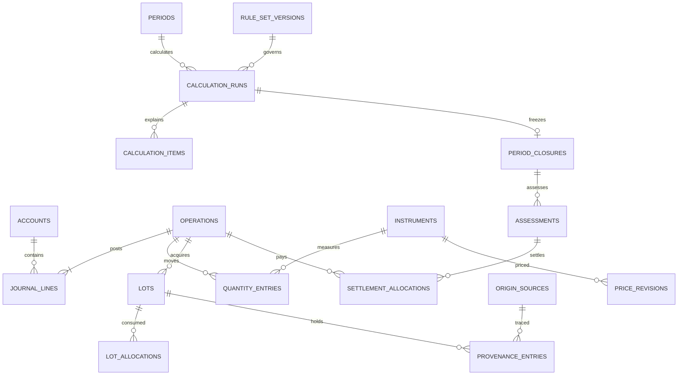

# مدل داده پیشنهادی

نسخه 0.2 — 2026-10-13؛ طرح منطقی مرحله‌ای برای migrationهای آینده؛ migration هویت فاز ۱ روی SQLite تازه اجرا شده است؛ فقط users/sessions و metadata migrations واقعی‌اند و جدول‌های دامنه آینده هنوز طرح‌اند. ۴۸ جدول دامنه در طرح مقصد، نه تعهد به ساخت هم‌زمان؛ جدول‌های framework در این شمارش نیستند.

## قرارداد عمومی

کلید داخلی BIGINT، شناسه عمومی تصادفی برای URL و idempotency، FKهای صریح و `ON DELETE RESTRICT` برای سوابق مالی. وضعیت‌ها string محدود با enum در PHP و CHECK قابل پشتیبانی در DB. استفاده از enum اختصاصی MySQL یا JSON query برای هسته محاسبه ممنوع. JSON فقط برای snapshot/metadata نسخه‌دار با schema و اعداد رشته‌ای است؛ مبلغ/مقدار مهم ستون دارد.

`*_rial`: عدد صحیح signed BIGINT با دامنه کنترل‌شده؛ حد هر مبلغ و مانده مجاز در نسخه اول 9,000,000,000,000,000 ریال پیشنهاد می‌شود. جمع و ضرب با عدد بزرگ دقیق انجام می‌شود و قبل از persist کنترل دامنه دارد. `*_atoms`: رشته صحیح حداکثر ۷۸ رقم با scale ثابت ابزار؛ قیمت/CPI عدد دهدهی canonical در VARCHAR محدود. محاسبه روی متن با SQL `SUM`/`CAST REAL` ممنوع. انتخاب TEXT/VARCHAR برای کسرها به این دلیل است که DECIMAL در SQLite تضمین decimal ثابت ندارد. [نوع داده SQLite](https://www.sqlite.org/datatype3.html)

تاریخ رویداد: `effective_date` تاریخ استانداردِ روز محلی، `time_precision=date|instant`، `effective_at` زمان UTC با دقت microsecond فقط در صورت معلوم‌بودن ساعت (وگرنه null)، `recorded_at` زمان واقعی ثبت و `sequence` ترتیب پایدار داخل روز/زمان یکسان. ترتیب مالیِ ورودی روزانه با ترتیب صریح ثبت/تأیید کاربر قابل بازسازی است؛ از آن ساعت واقعی استنتاج نمی‌شود. اگر ترتیب دو رویداد بر موجودی/منشأ اثر دارد و معلوم نیست، پیش‌نویس/تعارض لازم است. در روز مرز، `boundary_relation=before|after|unknown` با تأیید و مرجع مرز نگهداری می‌شود؛ عملیات مبهم به سال قطعی منتسب نمی‌شود. بازه روزانه در گزارش مالی از instant شرعی جداست. تاریخ شمسی تنها کلید ثانویه برای CPI و تنظیم سال است، نه جایگزین زمان استاندارد. رویدادهای قمری، روش تبدیل و تاریخ مورد تأیید خود را نیز نگه می‌دارند.

## روابط اصلی

این ERD خلاصه است؛ روابط تکمیلی در جدول‌های زیر الزام طراحی‌اند. جدول‌های مشتق با authoritative اشتباه نشوند.

## هویت و دفترکل

| جدول | ستون‌های کلیدی | روابط/قید |
|---|---|---|
| users | id، login، password، disabled_at، timestamps | password نام استاندارد Laravel برای ستون hash است؛ مسیر ایجاد مالک فقط id=1؛ سیاست دسترسی حتی تک‌کاربره |
| settings_versions | key، value، version، effective_from، approved_by | نسخه به‌جای overwrite تنظیم مؤثر مالی |
| dataset_state | id ثابت، revision، updated_at | قفل مشترک نویسندگان مالی/مبنا |
| accounts | code، name، class، subtype، parent_id، currency، archived_at | class: asset/liability/equity/income/expense؛ دسته بانکی/نقد/کارگزاری/نگهداری |
| categories | name، kind، archived_at | دسته UX درآمد/هزینه؛ جایگزین حکم شرعی نیست |
| operations | public_id، type، effective_date، effective_at nullable، time_precision، boundary_relation، recorded_at، sequence، status، idempotency_key، payload_hash، actor_id، reason، reversal_of_id، correction_group_id | unique idempotency؛ draft/posted؛ سند posted immutable؛ تاریخ و sequence شاخص دارند |
| journal_lines | operation_id، account_id، side، amount_rial، category_id، description | مبلغ مثبت؛ side debit/credit؛ جمع بدهکار=بستانکار در هر posted operation |
| obligations | kind receivable/payable، account_id، counterparty nullable، originated_at nullable، purpose، due_at، currency، instrument_id nullable، opening_item_id nullable، evidence | اصل و مانده از ledger؛ status محاسبه‌شده؛ افتتاحیه مجاز |
| obligation_allocations | obligation_id، journal_line_id، quantity_entry_id nullable، role، amount_rial، atoms nullable | principal/fee/interest/writeoff جدا؛ اصل دریافت/پرداخت دوباره‌شماری نشود |
| reconciliation_runs | account_id، as_of، statement_balance_rial، book_balance_rial، difference، evidence، approved_by | اختلاف فقط با operation اصلاحی حل می‌شود |

قرض ریالی از ledger خوانده می‌شود. تعهد ارزی یک حساب تفصیلی مختص همان تعهد و instrument دارد؛ quantity_entries در آن حساب مانده واحد اصلی را نگه می‌دارد، obligation_allocations سهم اصل/کارمزد را به خط مبلغ و خط مقدار مرتبط می‌کند. تاریخ ایجاد واقعی افتتاحیه nullable است. تا تکمیل و آزمون این مسیر در فاز ۴، ثبت نهایی قرض ارزی مسدود و پیش‌نویس مجاز است؛ تبدیل بی‌سند آن به ریال ممنوع. در `journal_lines` مبلغ همیشه ریالی است حتی اگر account ارزی باشد.

## ابزار، مقدار، بهای تمام‌شده و منشأ

| جدول | ستون‌های کلیدی | روابط/قید |
|---|---|---|
| instruments | code، type، unit، quantity_scale، symbol، quote_unit_atoms، metal nullable، form nullable، fineness_parts_per_10000 nullable، active | scale پس از اولین ثبت تغییر نمی‌کند؛ رمزارز/صندوق/فلز از هم متمایز |
| quantity_entries | operation_id، account_id، instrument_id، signed_atoms | دفتر مقدار مستقل؛ مانده از جمع دقیق؛ IRR نقد نیازی به نسخه تکراری مقدار ندارد |
| lots | acquisition_operation_id، opening_item_id nullable، instrument_id، account_id، acquired_at nullable، acquired_atoms، cost_rial، historical_cost_rial nullable، cost_basis_kind، acquisition_method | بهای دفتری معلوم، بهای تاریخی ممکن است نامعلوم؛ origin lot و رویداد انتقال؛ مانده مشتق |
| lot_allocations | projection_revision، exit_operation_id، source_lot_id، target_lot_id nullable، atoms، allocated_cost_rial | فروش/انتقال جزئی؛ مقدار و بها از موجودی قابل تخصیص بیشتر نشود |
| origin_sources | source_operation_id، opening_item_id nullable، kind، income_period_id nullable، evidence_status، evidence_id، original_amount_rial | kinds: opening/earned/gift/borrowed/realized_gain/other/unknown؛ مخمّس بودن در state مستقل |
| provenance_entries | projection_revision، operation_id، source_id، from_account_id، to_account_id، lot_id nullable، amount_rial، basis_kind، parent_entry_id | انتقال/مصرف/سود/زیان و اتصال به ریشه؛ مجموعه edges، بدون چرخه |
| religious_basis_events | source_id، lot_id nullable، opening_item_id nullable، effective_date/at، status، covered_rial nullable، covered_atoms nullable، basis_rial nullable، basis_atoms nullable، decision_id nullable، assessment_id nullable، settlement_id nullable | unknown/current_income/previously_settled/exempt_by_rule/assessed_unsettled؛ معاف با مخمّس یکی نیست |
| asset_fact_versions | lot_id یا instrument_id یا account_id، valid_from/to، recorded_at، intent، tradability، acquisition_nature، bank_type، legal_holding_form، ownership_share، evidence، source_id | دقیقاً یک target؛ واقعیت تاریخی، شواهد و وضعیت unknown |
| projection_revisions | sequence، input_hash، policy_version، from_effective_date، from_effective_at nullable، created_at | تخصیص‌های مشتق قبلی حذف نمی‌شوند؛ گزارش به نسخه اشاره می‌کند |

بهای تاریخی اقتصادی، ارزش بازار و پایه شرعی سه ستون/مفهوم جدا هستند. `religious_basis_events` افزایش پایه ناشی از تسویه را ثبت می‌کند، بدون دستکاری `lots.cost_rial`. فقدان منشأ با منبع explicit unknown بازنمایی می‌شود تا جمع منابع کامل و ابهام آشکار بماند. provenance دفتر دوم پول نیست؛ با journal/lot تطبیق داده می‌شود و جدا به ارزش کل جمع نمی‌شود.

در افتتاحیه این پروژه، مبلغ دفتری ارزش افتتاحیه مورد تأیید است (`cost_basis_kind=opening_valuation`)؛ `historical_cost_rial` و زمان تملک واقعی در نبود مدرک/اظهار مشخص، null می‌مانند. این مبلغ بهای تاریخی یا پایه مخمّس فرض نمی‌شود. برای FIFO، lot افتتاحیه با ترتیب مخصوصِ «موجود پیش از شروع ثبت» مدیریت می‌شود و محدودیت گزارش تمام عمر دارایی آشکار است.

## قیمت، CPI و تقویم

| جدول | ستون‌های کلیدی | روابط/قید |
|---|---|---|
| price_points | instrument_id، effective_at، price_kind، quote_unit_atoms | unique ترکیب کلید قیمت؛ تاریخ روزانه با precision مشخص |
| price_revisions | point_id، revision_no، price_rial_decimal، source_note، recorded_at، supersedes_id، withdrawn | unique point/revision؛ قیمت غیرمنفی؛ صفر فقط با تأیید ارزش صفر |
| cpi_series | provider، coverage، base_year، calendar، frequency، methodology_version، source_url | ماهانه شمسی؛ نام سری و دامنه با هم مقایسه شود |
| cpi_points | series_id، jalali_year/month، month_start_date، next_month_start_date | unique سری/ماه؛ تاریخ‌های میلادی بازه ماه |
| cpi_revisions | point_id، revision_no، value_decimal، published_at، recorded_at، source_note | مقدار مثبت؛ اصلاح نسخه‌ای؛ بدون interpolate خودکار |
| cpi_bridges | from_series_id، to_series_id، overlap_point_ids، factor_num/den، method، approved_by | فقط bridge دارای سند؛ چرخه و مسیر مبهم ممنوع |
| calendar_evidence | calendar_kind، native_date، resolved_utc، conversion_version، source/confirmation | به‌ویژه ماه قمری و ساعت/روز مرزی |
| import_batches | type، content_hash، status، validation_report، committed_at | پیش‌نمایش، خطای سطری، commit همه یا هیچ؛ retry بی‌تکرار |

اصلاح قیمت با revision جدید است؛ در گزارش بسته نسخه دقیق pinned است. وضعیت withdrawn یک نسخه حذف منطقی با تاریخچه است. انتخاب نسخه تابع knowledge_cutoff است، نه فقط بزرگ‌ترین id.

## قواعد، دوره و گزارش

| جدول | ستون‌های کلیدی | روابط/قید |
|---|---|---|
| ruling_sources | title، official_url، publication، issue_numbers، reviewed_at، verification_status | مسئله فقط در چارچوب کتاب/چاپ یکتا؛ URL رسمی |
| ruling_source_versions | source_id، content_hash nullable، excerpt، interpretation، ruling_kind، checked_at | هش فقط اگر واقعاً محاسبه شده؛ نسخه منبع از برداشت جدا |
| rule_set_versions | engine khums/zakat/economic، version، code_ref، manifest_hash، manifest_snapshot، activated_at | immutable بعد فعال‌سازی؛ کد اجرایی از DB/eval بارگذاری نمی‌شود |
| user_decisions | kind، rule_code nullable، scope، facts، selected_policy، evidence، approved_at، supersedes_id | تأیید موردی بدون حذف ابهام نامرتبط؛ تغییر تاریخچه‌ای |
| periods | kind، start_date، end_exclusive_date، start_at nullable، end_exclusive_at nullable، boundary_status، timezone، calendar، schedule_version، status | تاریخ اول ۱۴۰۵/۰۵/۲۰ تا ۱۴۰۶/۰۵/۲۰؛ timestampها فقط پس از تأیید ساعت؛ شروع<پایان و عدم هم‌پوشانی خمسی زیر قفل |
| zakat_cycles | period_id، category، start_at، due_at، next_cycle_at، lunar_evidence_id، rule_set_id | period_id یکتا و از نوع zakat؛ due با شروع دوره بعد یکی نیست |
| zakat_cycle_holdings | cycle_id، lot_id، qualifying_atoms، ownership_interval | cohortهای مربوط به نصاب و تداوم مالکیت |
| condition_evidence | cycle_id، condition_code، from_at/to_at، value true/false/unknown، evidence، confirmed_by | دو مشاهده قیمت اثبات تداوم شرط نیست |
| calculation_runs | engine، purpose simulation/period_report/amendment، period_id یا cycle_id، hypothetical_end_at nullable، assumptions، revision، input_hash، dataset_revision، rule_set_id، status، as_of، knowledge_cutoff، snapshot_payload/hash | ورودی/خروجی، scaleها، روش گردکردن و نسخه کد؛ همه مبلغ‌ها در JSON رشته |
| calculation_items | run_id، asset/lot/source reference، gross، excluded، eligible، due، status، rule_code، trace_payload | ارقام optional؛ علت، اسناد، قیمت/CPI و زنجیره تخصیص |
| review_issues | run_id، code، severity، affected_refs، reason، resolution_decision_id | رفع موضوع با مدرک؛ دکمه تأیید کلی جایگزین داده مفقود نیست |
| period_closures | period_id، revision، run_id، approved_by/at، supersedes_closure_id، reason | unique period/revision و unique run؛ نسخه جاری با CAS؛ purpose=simulation مجاز نیست |
| closure_dependencies | closure_id، depends_on_closure_id، input_hash | اصلاح سال قبل، وابستگی سال بعد را stale می‌کند |
| opening_basis_items | closure_id، source/lot_id، basis_kind، amount/atoms، settlement_status | فقط پایه شرعی انتقالی سال بعد؛ با opening_items راه‌انداز متفاوت و بدون اثر در مانده |
| assessments | closure_id، kind، assessed_rial، recognized_operation_id nullable، status | تعهد محاسباتی؛ شناسایی مالی و تسویه مستقل |
| settlement_allocations | assessment_id، payment_operation_id، amount_rial، confirmed_at | جمع تخصیص ≤ پرداخت و تعهد؛ پرداخت جزئی و چند سال |
| amendment_cases | affected_period_id nullable، reason، proposed_changes، old/new_run_id nullable، status، approved_by | اصلاح دوره باز یا بسته؛ پیش‌نمایش اختلاف، backup، نسخه جدید و آثار سال‌های بعد |
| audit_events | actor_id، action، object refs، before/after hash، reason، recorded_at | append-only برنامه‌ای؛ حذف زنجیره مالی ممنوع |
| backup_manifests | created_at، schema_version، checksum، encrypted_path، verified_at | مسیر خصوصی؛ بدون ذخیره کلید رمز در همان manifest |

تشخیص تقاطع خمس و زکات در لایه آماده‌سازی ورودی با `assessment`ها و شناسه مال انجام می‌شود؛ موتورهای مستقل نتایج هم را کورکورانه جمع/کسر نمی‌کنند.

گزارش و closure زکات به `period_id` چرخه خودش وصل می‌شوند؛ در محاسبه زکات، cycle و period باید به یک رکورد دوره اشاره کنند. سررسید ارزیابی از `zakat_cycles.due_at` گرفته می‌شود، نه پایان سال خمسی یا الزاماً انتهای بازه دوازده‌ماهه. دوره‌های زکات cohortهای متفاوت می‌توانند هم‌پوشان باشند.

## قیود مهم و مهاجرت

- FKها در هر اتصال SQLite فعال؛ index روی زمان/حساب، lot/ابزار، قیمت/زمان، سری/ماه، دوره/نسخه و کلید تکرار.
- balance سند قید چندردیفی است: Action در همان تراکنش کنترل می‌کند و replay/audit نیز کشف می‌کند؛ CHECK ساده جای آن را نمی‌گیرد.
- posted تنها وقتی مجاز است که خطوط دفترکل و مقدار و تخصیص لازم کامل باشند. UPDATE/DELETE مستقیم سوابق posted در مسیر برنامه مجاز نیست؛ محافظ DB متناسب با driver برای خطوط نهایی در فاز دفترکل آزموده شود.
- Soft delete فقط برای پیش‌نویس/داده مرجع بدون وابستگی؛ حساب دارای گردش archive می‌شود. برگشت سند، reversal جدید است و سند اصلی از گزارش تاریخی ناپدید نمی‌شود.
- migration schema ابتدا SQLite و سپس MySQL/MariaDB واقعی در CI مرحله سازگاری آزموده می‌شود؛ انتقال با خروجی logical نسخه‌دار، نه کپی فایل SQLite به موتور دیگر.
- collation، uniqueهای nullable، طول VARCHAR در SQLite، CHECK و تفاوت قفل‌ها در تست مشترک بررسی می‌شوند؛ هسته به ترتیب ضمنی SQL وابسته نیست.

## راه‌انداز و افتتاحیه

| جدول | ستون‌های کلیدی | روابط/قید |
|---|---|---|
| setup_sessions | dataset_id، status draft/ready/posted، current_step، step_states، revision، opening_date، boundary_status، prior_settlement_decision_id nullable، opening_operation_id nullable، approved_by/at، input_hash | unique dataset_id و unique opening_operation_id؛ فقط یک راه‌انداز اولیه؛ updated با CAS؛ پس از posted ثابت |
| opening_items | setup_session_id، ordinal، kind، account_id، instrument_id nullable، obligation_id nullable، amount_rial nullable، quantity_atoms nullable، opening_value_rial nullable، historical_cost_rial nullable، acquired_at nullable، ownership_status، financial_status، religious_status، details_schema_version، details_payload، evidence | unique session/ordinal؛ FK و مبلغ/مقدار typed؛ JSON فقط جزئیات نوعی/پیش‌نویس بخش‌های پایه؛ پس از تأیید immutable |

هر قسمت مخمّس/unknown پیش‌نویس با schema مشخص و عدد رشته‌ای داخل details_payload است؛ هنگام posting به religious_basis_events با مبلغ/مقدار پوشش و پایه جدا منتقل می‌شود و مرجع تأیید قلم حفظ می‌شود. محاسبه روی JSON پیش‌نویس یا SQL مبلغ رشته‌ای انجام نمی‌شود. برای دارایی مقداری مجموع covered_atoms = مقدار قلم؛ برای نقد مجموع covered_rial = مانده. basis_rial پایه شرعی است و با covered/value مخلوط نمی‌شود؛ مجهول null است. FK دوطرفه افتتاحیه و obligation ابتدا nullable و سپس در همان تراکنش تکمیل می‌شود؛ constraint فوری نقض نمی‌شود.

تا ساعت مرز مشخص نیست، opening_operation تاریخ استاندارد و precision=date دارد. periods تاریخ‌های قطعی و boundary_status=unconfirmed دارد؛ سرویس سررسید می‌تواند «نیاز به تعیین ساعت» نشان دهد، ولی instant/closure قطعی نمی‌سازد. تنظیمات مؤثر سال در settings_versions با روز/ماه، ساعت nullable، منطقه، زمان تأیید و دامنه اثر است؛ تغییر به نسخه جدید نیاز دارد.

## کاهش ساختار و ایجاد مرحله‌ای

- account_profiles حذف از طرح؛ واقعیت‌های بانک/نوع نگهداری در asset_fact_versions با تاریخچه حساب ثبت می‌شوند. جدول جدا برای همان واقعیت دوباره ساخته نشود.
- metal_details در instruments ادغام شد؛ ستون‌های اندک نوعی با validation متناسب با type. جنس/عیار/واحد بعد از گردش تغییر نمی‌کنند؛ تغییر واقعی ابزار/رویداد جدید می‌خواهد، نه بازتفسیر مقدار قبلی.
- rule_definitions جدول نیست؛ تعریف، facts لازم، وضعیت و source_version refs در manifest نسخه‌دار کد است. rule_set_versions نسخه و نسخه کامل manifest مصرف‌شده را نگه می‌دارد؛ شناسه rule در items با همان manifest اعتبارسنجی می‌شود. پنل ویرایش کد قواعد یا دومین کاتالوگ قابل انحراف نداریم.
- price_points/revisions و cpi_points/revisions حفظ شدند: هویت مشاهده و تاریخچه انتشار متفاوت‌اند. حذف نسخه‌ها برای کم‌کردن تعداد جدول‌ها ارزش حسابرسی را کم می‌کند.
- cpi_bridges فقط هنگام نیاز واقعی به اتصال دو سری و تأیید روش ساخته می‌شود؛ در عرضه اول CPI، سری یکپارچه رسمی یا نتیجه incomplete کافی است.
- setup_sessions/opening_items دو افزوده لازم برای ذخیره/ادامه و تأیید نسخه افتتاحیه‌اند؛ هیچ جدول اختصاصی برای هر نوع دارایی یا هر مرحله راه‌انداز اضافه نمی‌شود.

شمارش: ۴۹ جدول قبلی − ۳ جدول ادغام/حذف‌شده + ۲ جدول راه‌انداز = ۴۸ جدول منطقی مقصد. ساخت این مجموعه در فاز ۱ ممنوع است. نیاز واقعی هر فاز در ROADMAP تعیین می‌شود؛ phase ۱ تنها جداول لازم هویت/زیرساخت framework را می‌سازد. جدول‌های زکات و خروجی پیش از فاز مصرف‌کننده ساخته نمی‌شوند؛ amendment_cases در فاز ۵ برای اصلاح باز لازم است و در فاز ۸ پیوندهای closure را می‌گیرد.

قیود تکمیلی راه‌انداز: dataset_id به dataset_state تک‌ردیفی ارجاع دارد؛ تأیید قبلی به user_decisions و تأییدکننده به users متصل‌اند. مانده افتتاحیه هر قلم ریشه origin مستقل و قابل پیوند به opening_item دارد؛ یک source کلی نباید وضعیت همه اقلام را مخلوط کند. setup پیش‌نویس می‌تواند داده مرجع بسازد، ولی هیچ دفتر مالی پیش از تأیید نوشته نمی‌شود. وضعیت ready تنها آمادگی مالی پیش‌نمایش است، نه تأیید شرعی.

## محدوده migration آماده‌شده فاز ۱

فایل `database/migrations/2026_10_13_000000_create_identity_tables.php` تنها users و sessions را تعریف می‌کند؛ migrations جدول metadata خود Laravel است. migration در محیط محلی تازه و DBهای آزمایشی اجرا و آزموده شد. هیچ جدول دفترکل، دارایی، افتتاحیه، CPI، rule، audit مالی یا دوره‌های آینده ایجاد یا تعریف اجرایی نشده است.

users شامل کلید اصلی غیر incrementing، login یکتا، password هش‌شده استاندارد، disabled_at و timestamps است. اسم منطقی password_hash در طرح اولیه با ستون استاندارد password تطبیق داده شد؛ مقدار plaintext هرگز نگهداری نمی‌شود. مالک از CLI شناسه ۱ می‌گیرد و هویت دیگر مجوز access-app ندارد.

sessions جدول زیرساختی driver database است، با FK nullable user_id/ON DELETE SET NULL و payload/session metadata. payload پیش از ذخیره با APP_KEY رمز می‌شود. در بازیابی رمز، نشست‌های مالک حذف می‌شوند. این جدول در شمارش ۴۸ جدول دامنه مقصد منظور نشده بود و جای audit مالی آینده را نمی‌گیرد.

SQLite پیش‌فرض در storage/app/private/database.sqlite، foreign keys=true و busy timeout=5000 است. تست‌ها فقط SQLite in-memory دارند و قبل از RefreshDatabase config واقعی را رد می‌کنند. انتقال MySQL/MariaDB هنوز پیاده یا آزموده نشده؛ از Schema و FK استاندارد برای این migration استفاده شده، اما سازگاری مقصد فقط پس از تست واقعی ادعا می‌شود.

## نتیجه بررسی SQLite فاز ۱

PHP PDO SQLite با نسخه 3.45.1 فعال است. پایگاه جدید خصوصی تنها migrations، sessions و users دارد؛ تعداد مالک محلی صفر است و هیچ داده مالی وجود ندارد. .env و database.sqlite با permission 0600 ساخته شدند و محتوای APP_KEY نمایش داده نشد. پیش از این migration، پایگاه محلی وجود نداشت؛ به داده موجود نیاز به تغییر/backup نبود.

Pest روی SQLite in-memory و بررسی HTTP مستقل روی فایل موقتِ ساختگی اجرا شدند؛ FK و schema هویت در تست‌ها موفق‌اند. هیچ قید یا رفتار MySQL/MariaDB در این فاز آزموده/تأیید نشده است. پشتیبان و بازیابی مالی در فاز ۲ باقی می‌ماند.
