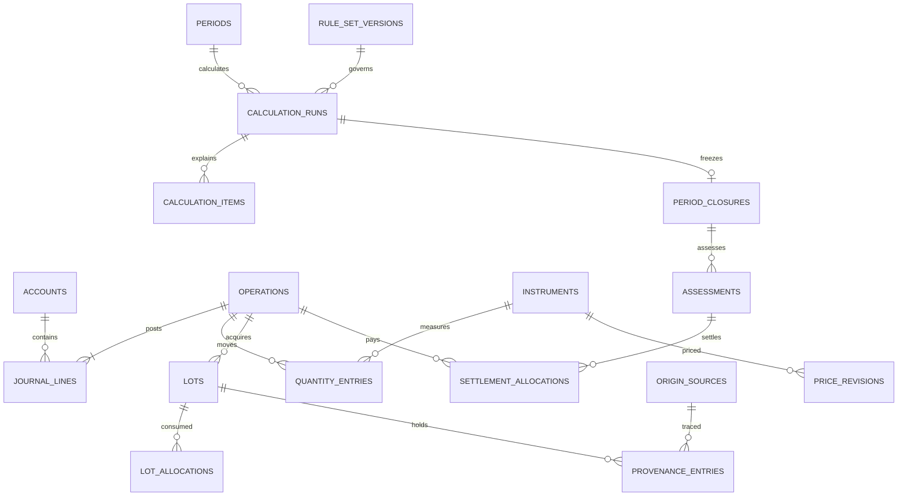

# مدل داده پیشنهادی

نسخه 0.1 — طرح منطقی و قیود لازم برای migrationهای آینده؛ هیچ جدول واقعی ساخته نشده است.

## قرارداد عمومی

کلید داخلی BIGINT، شناسه عمومی تصادفی برای URL و idempotency، FKهای صریح و `ON DELETE RESTRICT` برای سوابق مالی. وضعیت‌ها string محدود با enum در PHP و CHECK قابل پشتیبانی در DB. استفاده از enum اختصاصی MySQL یا JSON query برای هسته محاسبه ممنوع. JSON فقط برای snapshot/metadata نسخه‌دار با schema و اعداد رشته‌ای است؛ مبلغ/مقدار مهم ستون دارد.

`*_rial`: عدد صحیح signed BIGINT با دامنه کنترل‌شده؛ حد هر مبلغ و مانده مجاز در نسخه اول 9,000,000,000,000,000 ریال پیشنهاد می‌شود. جمع و ضرب با عدد بزرگ دقیق انجام می‌شود و قبل از persist کنترل دامنه دارد. `*_atoms`: رشته صحیح حداکثر ۷۸ رقم با scale ثابت ابزار؛ قیمت/CPI عدد دهدهی canonical در VARCHAR محدود. محاسبه روی متن با SQL `SUM`/`CAST REAL` ممنوع. انتخاب TEXT/VARCHAR برای کسرها به این دلیل است که DECIMAL در SQLite تضمین decimal ثابت ندارد. [نوع داده SQLite](https://www.sqlite.org/datatype3.html)

تاریخ رویداد: UTC با دقت microsecond در قالب یکسان؛ `effective_at` زمان اثر، `recorded_at` زمان ثبت، `sequence` ترتیب پایدار در زمان مساوی. ورودی صرفاً روز با `time_precision=date` و تاریخ میلادی معادل نگهداری می‌شود؛ اگر مرز ساعت سال داخل همان روز باشد، تعلق آن عملیات به دوره نیازمند تعیین ساعت/سمت مرز است. تاریخ شمسی تنها کلید ثانویه برای CPI و تنظیم سال است، نه جایگزین زمان استاندارد. رویدادهای قمری، روش تبدیل و تاریخ مورد تأیید خود را نیز نگه می‌دارند.

## روابط اصلی

این ERD خلاصه است؛ روابط تکمیلی در جدول‌های زیر الزام طراحی‌اند. جدول‌های مشتق با authoritative اشتباه نشوند.

## هویت و دفترکل

| جدول | ستون‌های کلیدی | روابط/قید |
|---|---|---|
| users | login، password_hash، disabled_at | یک مالک فعال؛ ایجاد از CLI؛ سیاست دسترسی حتی تک‌کاربره |
| settings_versions | key، value، version، effective_from، approved_by | نسخه به‌جای overwrite تنظیم مؤثر مالی |
| dataset_state | id ثابت، revision، updated_at | قفل مشترک نویسندگان مالی/مبنا |
| accounts | code، name، class، subtype، parent_id، currency، archived_at | class: asset/liability/equity/income/expense؛ دسته بانکی/نقد/کارگزاری/نگهداری |
| account_profiles | account_id، bank_type، legal_holding_form، evidence | واقعیت لازم برای حکم اختلاط، nullable و نیازمند تأیید |
| categories | name، kind، archived_at | دسته UX درآمد/هزینه؛ جایگزین حکم شرعی نیست |
| operations | public_id، type، effective_at، recorded_at، sequence، status، idempotency_key، payload_hash، actor_id، reason، reversal_of_id، correction_group_id | unique idempotency؛ draft/posted؛ سند posted immutable؛ تاریخ و sequence شاخص دارند |
| journal_lines | operation_id، account_id، side، amount_rial، category_id، description | مبلغ مثبت؛ side debit/credit؛ جمع بدهکار=بستانکار در هر posted operation |
| obligations | kind receivable/payable، account_id، counterparty، originated_at، purpose، due_at، currency، evidence | اصل و مانده از ledger؛ status محاسبه‌شده؛ افتتاحیه مجاز |
| obligation_allocations | obligation_id، journal_line_id، role، amount_rial | principal/fee/interest/writeoff جدا؛ اصل دریافت/پرداخت دوباره‌شماری نشود |
| reconciliation_runs | account_id، as_of، statement_balance_rial، book_balance_rial، difference، evidence، approved_by | اختلاف فقط با operation اصلاحی حل می‌شود |

برای قرض ریالی مدل کامل است. قرض ارزی نیازمند ابزار مقدار و قیمت و تست ارزی است؛ تا تکمیل آن مسیر، تبدیل بی‌سند قرض ارزی به ریال ممنوع. در `journal_lines` مبلغ همیشه ریالی است حتی اگر account ارزی باشد.

## ابزار، مقدار، بهای تمام‌شده و منشأ

| جدول | ستون‌های کلیدی | روابط/قید |
|---|---|---|
| instruments | code، type، unit، quantity_scale، symbol، quote_unit_atoms، active | scale پس از اولین ثبت تغییر نمی‌کند؛ رمزارز/صندوق/فلز از هم متمایز |
| metal_details | instrument_id، metal، form، fineness_parts_per_10000، weight_unit | قیمت هم‌عیار/هم‌واحد؛ مشخصه مؤثر با سابقه تغییر کند |
| quantity_entries | operation_id، account_id، instrument_id، signed_atoms | دفتر مقدار مستقل؛ مانده از جمع دقیق؛ IRR نقد نیازی به نسخه تکراری مقدار ندارد |
| lots | acquisition_operation_id، instrument_id، account_id، acquired_at nullable، acquired_atoms، cost_rial، historical_cost_rial nullable، cost_basis_kind، acquisition_method | بهای دفتری معلوم، بهای تاریخی ممکن است نامعلوم؛ origin lot و رویداد انتقال؛ مانده مشتق |
| lot_allocations | projection_revision، exit_operation_id، source_lot_id، target_lot_id nullable، atoms، allocated_cost_rial | فروش/انتقال جزئی؛ مقدار و بها از موجودی قابل تخصیص بیشتر نشود |
| origin_sources | source_operation_id، kind، income_period_id nullable، evidence_status، evidence_id، original_amount_rial | kinds: opening/earned/gift/borrowed/realized_gain/other؛ مخمّس بودن در state مستقل |
| provenance_entries | projection_revision، operation_id، source_id، from_account_id، to_account_id، lot_id nullable، amount_rial، basis_kind، parent_entry_id | انتقال/مصرف/سود/زیان و اتصال به ریشه؛ مجموعه edges، بدون چرخه |
| religious_basis_events | source_id، lot_id nullable، effective_at، status، basis_rial/atoms، decision_id، assessment_id، settlement_id | unknown/current_income/previously_settled/exempt_by_rule/assessed_unsettled؛ معاف با مخمّس یکی نیست |
| asset_fact_versions | lot_id یا instrument_id یا account_id، valid_from/to، recorded_at، intent، tradability، acquisition_nature، source_id | دقیقاً یک target؛ واقعیت تاریخی، شواهد و وضعیت unknown |
| projection_revisions | sequence، input_hash، policy_version، from_effective_at، created_at | تخصیص‌های مشتق قبلی حذف نمی‌شوند؛ گزارش به نسخه اشاره می‌کند |

بهای تاریخی اقتصادی، ارزش بازار و پایه شرعی سه ستون/مفهوم جدا هستند. `religious_basis_events` افزایش پایه ناشی از تسویه را ثبت می‌کند، بدون دستکاری `lots.cost_rial`. فقدان منشأ با منبع explicit unknown بازنمایی می‌شود تا جمع منابع کامل و ابهام آشکار بماند. provenance دفتر دوم پول نیست؛ با journal/lot تطبیق داده می‌شود و جدا به ارزش کل جمع نمی‌شود.

در افتتاحیه بدون سوابق خرید، مبلغ دفتری می‌تواند ارزش افتتاحیه مورد تأیید باشد (`cost_basis_kind=opening_valuation`)؛ `historical_cost_rial` و زمان تملک واقعی نامعلوم می‌مانند. این مبلغ بهای تاریخی یا پایه مخمّس فرض نمی‌شود. برای FIFO، lot افتتاحیه با ترتیب مخصوصِ «موجود پیش از شروع ثبت» مدیریت می‌شود و محدودیت گزارش تمام عمر دارایی آشکار است.

## قیمت، CPI و تقویم

| جدول | ستون‌های کلیدی | روابط/قید |
|---|---|---|
| price_points | instrument_id، effective_at، price_kind، quote_unit_atoms | unique ترکیب کلید قیمت؛ تاریخ روزانه با precision مشخص |
| price_revisions | point_id، revision_no، price_rial_decimal، source_note، recorded_at، supersedes_id، withdrawn | unique point/revision؛ قیمت غیرمنفی؛ صفر فقط با تأیید ارزش صفر |
| cpi_series | provider، coverage، base_year، calendar، frequency، methodology_version، source_url | ماهانه شمسی؛ نام سری و دامنه با هم مقایسه شود |
| cpi_points | series_id، jalali_year/month، month_start_date، next_month_start_date | unique سری/ماه؛ تاریخ‌های میلادی بازه ماه |
| cpi_revisions | point_id، revision_no، value_decimal، published_at، recorded_at، source_note | مقدار مثبت؛ اصلاح نسخه‌ای؛ بدون interpolate خودکار |
| cpi_bridges | from_series_id، to_series_id، overlap_point_ids، factor_num/den، method، approved_by | فقط bridge دارای سند؛ چرخه و مسیر مبهم ممنوع |
| calendar_evidence | calendar_kind، native_date، resolved_utc، conversion_version، source/confirmation | به‌ویژه ماه قمری و ساعت/روز مرزی |
| import_batches | type، content_hash، status، validation_report، committed_at | پیش‌نمایش، خطای سطری، commit همه یا هیچ؛ retry بی‌تکرار |

اصلاح قیمت با revision جدید است؛ در گزارش بسته نسخه دقیق pinned است. وضعیت withdrawn یک نسخه حذف منطقی با تاریخچه است. انتخاب نسخه تابع knowledge_cutoff است، نه فقط بزرگ‌ترین id.

## قواعد، دوره و گزارش

| جدول | ستون‌های کلیدی | روابط/قید |
|---|---|---|
| ruling_sources | title، official_url، publication، issue_numbers، reviewed_at، verification_status | مسئله فقط در چارچوب کتاب/چاپ یکتا؛ URL رسمی |
| ruling_source_versions | source_id، content_hash nullable، excerpt، interpretation، ruling_kind، checked_at | هش فقط اگر واقعاً محاسبه شده؛ نسخه منبع از برداشت جدا |
| rule_set_versions | engine khums/zakat/economic، version، code_ref، manifest_hash، activated_at | immutable بعد فعال‌سازی؛ کد اجرایی از DB/eval بارگذاری نمی‌شود |
| rule_definitions | rule_set_id، code، source_version_id، required_facts، status | draft/reviewed/tested/active؛ ترتیب و dependencies در manifest |
| user_decisions | rule_code، scope، facts، selected_policy، evidence، approved_at، supersedes_id | تأیید موردی بدون حذف ابهام نامرتبط؛ تغییر تاریخچه‌ای |
| periods | kind، start_at، end_exclusive_at، timezone، calendar، schedule_version، status | start<end؛ عدم هم‌پوشانی سال خمسی در سرویس و قفل؛ نه الزام برای همه cohortهای زکات |
| zakat_cycles | period_id، category، start_at، due_at، next_cycle_at، lunar_evidence_id، rule_set_id | period_id یکتا و از نوع zakat؛ due با شروع دوره بعد یکی نیست |
| zakat_cycle_holdings | cycle_id، lot_id، qualifying_atoms، ownership_interval | cohortهای مربوط به نصاب و تداوم مالکیت |
| condition_evidence | cycle_id، condition_code، from_at/to_at، value true/false/unknown، evidence، confirmed_by | دو مشاهده قیمت اثبات تداوم شرط نیست |
| calculation_runs | engine، period_id یا cycle_id، revision، input_hash، dataset_revision، rule_set_id، status، as_of، knowledge_cutoff، snapshot_payload/hash | ورودی/خروجی، scaleها، روش گردکردن و نسخه کد؛ همه مبلغ‌ها در JSON رشته |
| calculation_items | run_id، asset/lot/source reference، gross، excluded، eligible، due، status، rule_code، trace_payload | ارقام optional؛ علت، اسناد، قیمت/CPI و زنجیره تخصیص |
| review_issues | run_id، code، severity، affected_refs، reason، resolution_decision_id | رفع موضوع با مدرک؛ دکمه تأیید کلی جایگزین داده مفقود نیست |
| period_closures | period_id، revision، run_id، approved_by/at، supersedes_closure_id، reason | unique period/revision و unique run؛ نسخه جاری در period با CAS |
| closure_dependencies | closure_id، depends_on_closure_id، input_hash | اصلاح سال قبل، وابستگی سال بعد را stale می‌کند |
| opening_basis_items | closure_id، source/lot_id، basis_kind، amount/atoms، settlement_status | فقط پایه شرعی انتقالی؛ تکرار مانده دفترکل نیست |
| assessments | closure_id، kind، assessed_rial، recognized_operation_id nullable، status | تعهد محاسباتی؛ شناسایی مالی و تسویه مستقل |
| settlement_allocations | assessment_id، payment_operation_id، amount_rial، confirmed_at | جمع تخصیص ≤ پرداخت و تعهد؛ پرداخت جزئی و چند سال |
| amendment_cases | affected_period_id، reason، proposed_changes، old/new_run_id، status، approved_by | پیش‌نمایش اختلاف، backup، نسخه جدید و آثار سال‌های بعد |
| audit_events | actor_id، action، object refs، before/after hash، reason، recorded_at | append-only برنامه‌ای؛ حذف زنجیره مالی ممنوع |
| backup_manifests | created_at، schema_version، checksum، encrypted_path، verified_at | مسیر خصوصی؛ بدون ذخیره کلید رمز در همان manifest |

تشخیص تقاطع خمس و زکات در لایه آماده‌سازی ورودی با `assessment`ها و شناسه مال انجام می‌شود؛ موتورهای مستقل نتایج هم را کورکورانه جمع/کسر نمی‌کنند.

گزارش و closure زکات به `period_id` چرخه خودش وصل می‌شوند؛ در محاسبه زکات، cycle و period باید به یک رکورد دوره اشاره کنند. سررسید ارزیابی از `zakat_cycles.due_at` گرفته می‌شود، نه پایان سال خمسی یا الزاماً انتهای بازه دوازده‌ماهه. دوره‌های زکات cohortهای متفاوت می‌توانند هم‌پوشان باشند.

## قیود مهم و مهاجرت

- FKها در هر اتصال SQLite فعال؛ index روی زمان/حساب، lot/ابزار، قیمت/زمان، سری/ماه، دوره/نسخه و کلید تکرار.
- balance سند قید چندردیفی است: Action در همان تراکنش کنترل می‌کند و replay/audit نیز کشف می‌کند؛ CHECK ساده جای آن را نمی‌گیرد.
- posted تنها وقتی مجاز است که خطوط دفترکل و مقدار و تخصیص لازم کامل باشند. UPDATE/DELETE مستقیم سوابق posted در مسیر برنامه مجاز نیست؛ محافظ DB متناسب با driver برای خطوط نهایی در فاز دفترکل آزموده شود.
- Soft delete فقط برای پیش‌نویس/داده مرجع بدون وابستگی؛ حساب دارای گردش archive می‌شود. برگشت سند، reversal جدید است و سند اصلی از گزارش تاریخی ناپدید نمی‌شود.
- migration schema ابتدا SQLite و سپس MySQL/MariaDB واقعی در CI مرحله سازگاری آزموده می‌شود؛ انتقال با خروجی logical نسخه‌دار، نه کپی فایل SQLite به موتور دیگر.
- collation، uniqueهای nullable، طول VARCHAR در SQLite، CHECK و تفاوت قفل‌ها در تست مشترک بررسی می‌شوند؛ هسته به ترتیب ضمنی SQL وابسته نیست.
