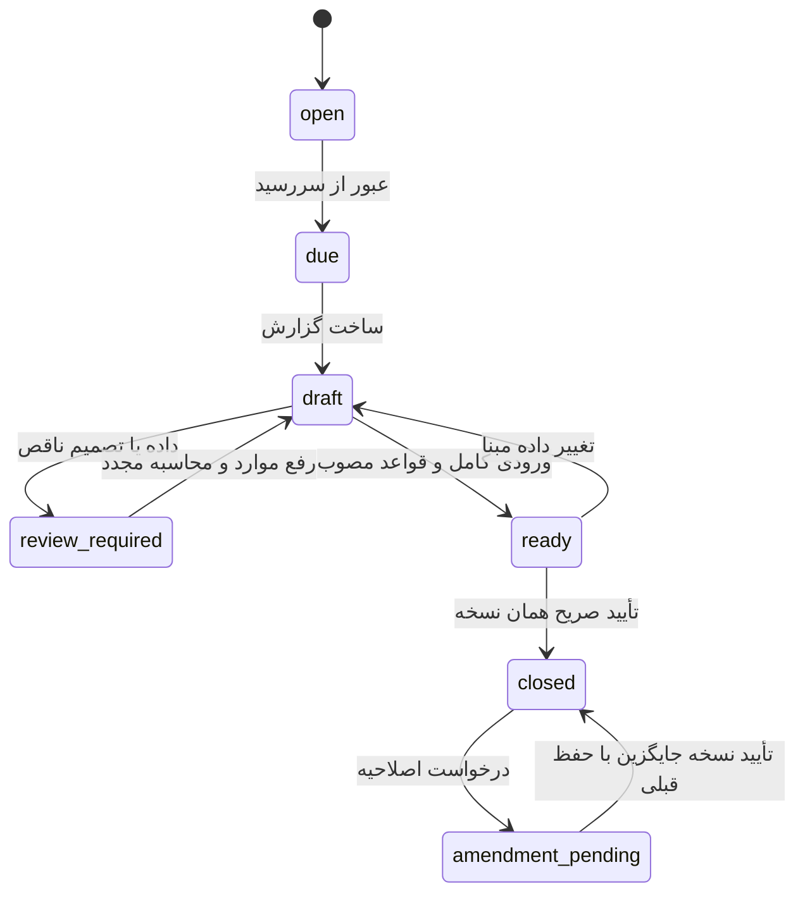

# طراحی موتور خمس

نسخه پیشنهادی `khums-draft-v0.1` — هیچ قاعده شرعی در این فاز فعال نشده است. منبع تفصیلی و وضعیت بررسی هر ارجاع در [RULING_SOURCES](RULING_SOURCES.md) است.

## قرارداد موتور

ورودی immutable: دوره با ساعت دقیق، snapshot دارایی/بدهی، قیمت معتبر، منشأ و پایه شرعی هر سهم، جریان‌ها، مؤونه/وضعیت شغلی، intent تاریخی، وضعیت قابلیت فروش/دریافت، سابقه تعهد/پرداخت، نسخه قواعد و تصمیم‌ها. CPI فقط در شاخه‌ای وارد می‌شود که نقش آن صریحاً مصوب شده؛ موتور مالی وابستگی اجباری به حکم ندارد.

خروجی هر قلم: شناسه دارایی/lot/منشأ، ارزش بررسی‌شده، اصل محافظت‌شده، عایدی بررسی‌شده، تعدیلات مثبت/منفی با دلیل، مبلغ کنارگذاشته‌شده از مبنا، مبلغ مشمول، خمس پیشنهادی، وضعیت و زنجیره توضیح. «کنارگذاشته‌شده» علت نوع‌دار دارد: اصل مخمّس، معافیت، مؤونه، جبران مصوب؛ همه با عنوان معافیت یکسان گزارش نمی‌شوند.

وضعیت‌ها: `computed` (کامل طبق فروض و قاعده)، `needs_review` (حکم/تصمیم/واقعیت مبهم)، `incomplete` (داده عددی مفقود)، `not_applicable` (با دلیل)، `provisional` (وابستگی یا قیمت تأییدنشده). وضعیت source verification از وضعیت مبلغ جداست. مجموع معلوم نمایش داده می‌شود ولی اگر قلم مؤثر حل‌نشده باشد `total_due=null` و `known_subtotal` جدا است؛ صفر به‌معنی فقدان تکلیف فقط با نتیجه معتبر.

## مراحل ارزیابی و جلوگیری از دوباره‌شماری

1. کنترل صحت دفترکل، مقدار، منبع و کامل‌بودن افتتاحیه/دوره.
2. ساخت قطعات پایه از مال موجود و حقوق/تعهدهای مرتبط در سررسید؛ هر سهم یک `basis_component_id` یکتا.
3. دسته‌بندی منشأ و قصد، روش تملک، وضعیت پرداخت قبلی و قابلیت فروش. شاخه خاص سهام/طلا/ارز قبل از قاعده عمومی انتخاب می‌شود.
4. جداسازی اصل مخمّس/در حکم مخمّس طبق مبنای اثبات‌شده؛ خرید با درآمد به‌تنهایی آن را مخمّس نمی‌کند.
5. تعیین زمان و مبنای شناسایی افزایش قیمت طبق قاعده مربوط؛ سود فروش برگشتی به دارایی دیگر فقط یک‌بار در component درآمد حضور دارد.
6. اعمال مؤونه، زیان و بدهی صرفاً با شرط و مدرک مصوب. هر deduction شناسه مصرف دارد تا روی چند دارایی/سال دوباره استفاده نشود.
7. شاخه تورم و احتیاط/تصمیم معتبر، سپس تجمیع componentهای بدون تداخل. قاعده عمومی «خالص دارایی منهای همه بدهی‌ها» جای این pipeline نیست.
8. در مبنای کامل و مجازِ متعارف، خمس = مبلغ مشمول × ۱/۵؛ شیوه پرداخت و موارد خاص ممکن است محاسبه جدا لازم داشته باشد. این نرخ مجوز تشخیص خودکار مبلغ مشمول نیست.

اگر مبنا از **دارایی باقیمانده** ساخته شده، هزینه زندگی که قبلاً موجودی را کم کرده دوباره از کل کسر نمی‌شود. اگر گزارشی از جریان درآمد شروع می‌کند، باید با مبنای موجودی reconcile شود، نه اینکه هر دو مبنا جمع شوند. همین کنترل برای سود تحقق‌نیافته‌ای که سال قبل تخمیس شده و امسال فروخته شده لازم است: بهای اقتصادی قدیمی می‌ماند ولی پایه شرعیِ قبلاً تخمیس‌شده از افزایش بعدی جدا می‌شود (R-K16).

## جدول قواعد طراحی

| شناسه | مسیر | منبع / پیش‌شرط | رفتار در ابهام |
|---|---|---|---|
| K01 | اصل مخمّس و تبدیل داخلی | پایه معتبر، ردگیری کامل؛ R-K16/R-K17 برای پایه پس از پرداخت | منشأ unknown منتقل شود؛ اصل فرضی نساز |
| K02 | درآمد و هدیه باقیمانده | R-K01؛ سال، مؤونه و استثناها معلوم | نیازمند بررسی؛ هدیه همیشه معاف نیست |
| K03 | سرمایه خریداری‌شده با درآمد | R-K03؛ نوع و شرایط سرمایه | خرید را هزینه زندگی تلقی نکن |
| K04 | افزایش دارایی تجاری | R-K04؛ قصد، امکان فروش/دریافت و استثناها | داده لازم مطالبه شود |
| K05 | افزایش غیرتجاری | R-K05؛ روش تملک و فروش و پایه | یک حکم برای همه اموال اعمال نشود |
| K06 | حفظ ارزش | R-K07؛ قصد و منشأ اثبات‌شده | تغییر نام دسته معافیت نمی‌سازد |
| K07 | سهام و سود | R-K08؛ ساختار حق و قصد و قابلیت وصول | اطلاعات داخلی نامعلوم را صفر نکن |
| K08 | طلا/ارز | R-K09/R-K10؛ حرفه و معیار مصوب | ریال ledger معیار شرعی خودکار نیست |
| K09 | زیان/جبران | R-K11 و تکمیل منابع وابسته | همه زیان‌ها تهاتر نشوند |
| K10 | بدهی/طلب | R-K12 و تکمیل شرایط | اصل قرض درآمد نیست؛ کسر شرعی جدا |
| K11 | اثر تورم | R-K06؛ تصمیم معتبر و روش انتساب مصوب | CPI اقتصادی ≠ معافیت شرعی؛ needs_review |
| K12 | مصرف پول مخلوط | R-K02؛ facts حساب/عین/طلب و شواهد | سیاست حسابداری تنها موقت |
| K13 | تداخل حقوق شرعی | R-KZ01 و assessmentهای وابسته | جلوگیری از جمع/کسر مکانیکی دو موتور |

متن صفحه [تورم، مسئله ۶۴۷](https://www.sistani.org/persian/book/26576/6358/) بین افزایش واقعی و فرض مورد احتیاط فرق می‌گذارد. **انتخاب شاخص مرکز آمار و فرمول اقتصادی ما، خودِ تأیید انطباق با آن حکم نیست.** تصمیم کاربر درباره عمل به احتیاط یا مسیر مستند دیگر و تعیین کاربرد CPI باید جدا ثبت شود؛ بدون آن عدد اقتصادی فقط در گزارش اقتصادی است.

## چرخه سال

تنظیم ابتدایی درخواست‌شده: ۲۰ مرداد؛ ساعت و معنای پایان روز هنوز باز است (Q01). پشتیبانی از ساعت مشخص لازم است؛ منبع R-K14. دوره `[start_at,end_exclusive_at)` و همه رویدادها با همان قرارداد. افزودن ۳۶۵ روز روش ساخت سال شمسی نیست؛ از تاریخ شمسی سال بعد و تبدیل آزموده استفاده می‌شود. روز نامعتبر مثل ۳۰ اسفند غیرکبیسه رد یا با سیاستِ صریحِ ازپیش‌تأییدشده حل می‌شود.

وضعیت تسویه محور جداست: `unpaid / partially_paid / settled / adjusted`. بسته بودن گزارش به‌معنی تسویه نیست. محاسبه هر تعداد بار مجاز؛ تأیید همان نسخه دوباره هیچ اثر جدیدی ندارد. آماده‌سازی پیش‌نویس‌های عقب‌افتاده بدون Cron در [ARCHITECTURE](ARCHITECTURE.md) تعریف شده است.

## بستن اتمیک

پیش از بستن: دوره سررسیدشده، قواعد فعال و نسخه‌دار، داده‌های مؤثر کامل، اشکالات مسدودکننده حل‌شده، وابستگی سال قبل معتبر و پیش‌نمایش آخرین نسخه. تأیید کاربر نباید جای قیمت نامعلوم، فقدان منشأ یا قاعده نامشخص را بگیرد؛ تصمیم مستند باید واقعاً موضوع ابهام را حل کند. آرشیو یک پیش‌نویس ناقص ممکن است، ولی «بسته قطعی» نام ندارد.

در تراکنش: قفل dataset/period → بازبینی input hash/version → درج closure یکتا → ذخیره snapshot کامل و trace → ثبت assessment → ایجاد opening basis سال بعد با تفکیک مخمّس قطعی، معاف مستند، نامشخص و تعهد تسویه‌نشده → audit. سند پرداخت یا افزایش موجودی ساخته نمی‌شود؛ مانده ledger از سال قبل پیوسته است و افتتاحیه دوباره حسابداری نمی‌شود.

snapshot: ردیف‌های دفترکل/مقدار لازم، تخصیص lot/source، قیمت‌های مصرف‌شده و زمانشان، CPIهای مصرف‌شده یا missing، عوامل اتصال شاخص، تصمیم‌ها، نسخه source/rule/code/schema/calendar/rounding، همه ارقام، issues و hash. فقط شناسه به جدول زنده کافی نیست. خروجی PDF/Excel نهایی از snapshot تهیه می‌شود.

## پرداخت و پایه سال بعد

ثبت پرداخت صفحه و تأیید خودش را دارد: مبلغ، تاریخ، حساب/دارایی پرداخت‌کننده، روش/منشأ، assessment مقصد، مدرک. پرداخت جزئی با سهم مشخص؛ پرداخت خارج از برنامه با سند تاریخی مستند وارد می‌شود. روش تسویه تعیین می‌کند کدام پایه و چه مقدار تغییر کند؛ R-K17. اگر فقط گزارش تأیید شد ولی خمس پرداخت نشد، آن سهم `assessed_unsettled` باقی می‌ماند و سال بعد نه دوباره بدون قاعده اخذ می‌شود و نه مخمّس محسوب می‌شود.

مصالحه/دستگردان/اجازه، پرداخت از درآمد سال بعد و پرداخت از مال دیگر به قواعد اختصاصی و مدرک نیاز دارند. محصول در نبود آنها سناریو را review می‌کند. خطی‌کردن همه پرداخت‌ها به «۲۰٪ بده و کل را مخمّس کن» ممنوع است.

## اصلاح سال بسته و تغییر سررسید

اصلاحیه: دلیل → انتخاب دوره و اسناد → بررسی آثار همه سال‌های وابسته → نسخه محاسبه جدید در محیط preview → نمایش اختلاف پایه/تعهد/تسویه → backup → تأیید مستقل → ایجاد revision و پیوند به نسخه قبلی. پرداخت‌های واقعی قبلی پاک نمی‌شوند؛ اختلاف تعهد/اضافه‌پرداخت جدا می‌آید. سال‌های بعد که بر پایه قبلی بسته شده‌اند «نیازمند اصلاح وابسته» می‌گیرند؛ نسخه آنها خودکار عوض نمی‌شود. بستن سال جدید تا رفع وابستگی مؤثر متوقف است.

تغییر سررسید فقط برای آینده با `schedule_version` و طرح دوره گذار است؛ دوره بسته overwrite نمی‌شود. جلو/عقب‌بردن سال، حسابرسی میانی و تصمیم لازم را دارد؛ [مسائل ۵۷۸ و ۵۷۹](https://www.sistani.org/persian/book/26576/6011/). UI پیش از ذخیره تقویم جدید، بازه‌ها و الزامات بررسی را نشان می‌دهد.

## مرز قطعیت

جمع اسناد، تبدیل تومان، تخصیص بهای مصوب و انتخاب قیمت تاریخی با ورودی کامل قطعی محاسباتی‌اند. قصد نگهداری، ماهیت حساب، مؤونه، معافیت، خسارت قابل جبران و اجازه شرعی facts/قواعد تأییدشده می‌خواهند. محاسبه خودکار با فروض تأییدشده خروجی قابل اتکا می‌دهد؛ برنامه هیچ فرض ناشناخته‌ای را برای رسیدن به یک عدد نهایی پنهان نمی‌کند.
