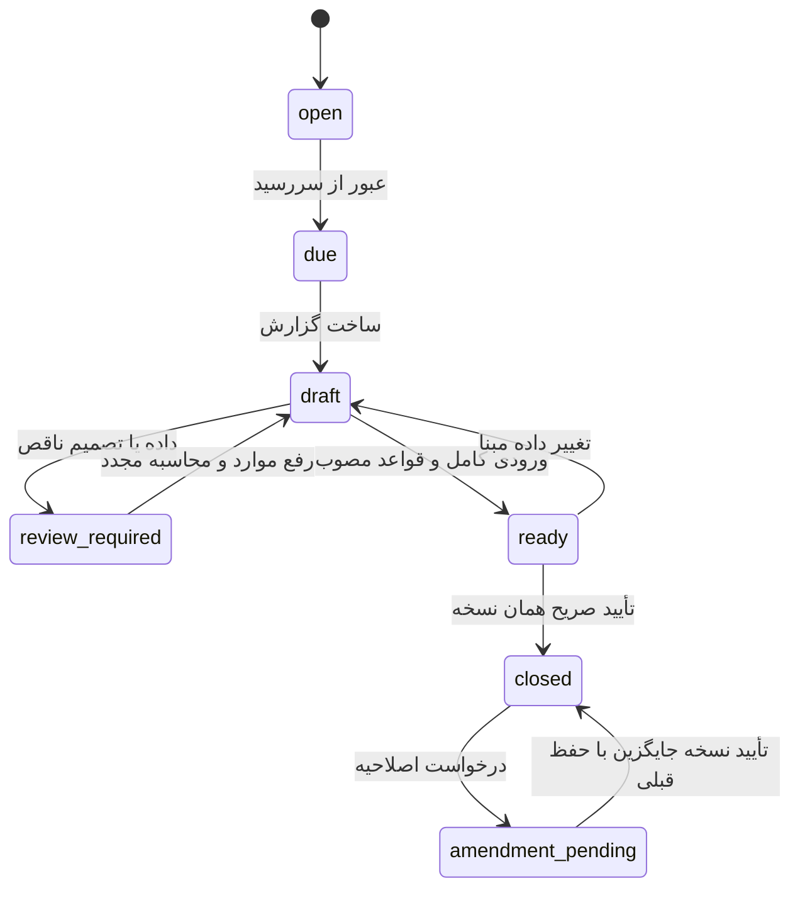

# طراحی موتور خمس

## مستند مستقل مبلغ پرداختیِ کسری ریال — 2026-10-23

مسیر khums_fractional_settlement یک قرارداد نرم‌افزاریِ پذیرش مستند موردی است. هیچ قاعدهٔ واقعی یا شمارهٔ مسئله برای گردکردن ساخته یا فعال نشده است. K-EXCESS بدون capability مخصوص این مسیر پذیرفته نمی‌شود؛ مسئلهٔ ۸۵۵ جای مجوز گردکردن نیست. قابلیت فعلی فقط مبلغ صحیح بالاترِ مجاور را با مستند همان تعهد پشتیبانی می‌کند و مبلغ محاسبه را تغییر نمی‌دهد. رضایت یا حدس تقریبی کاربر به‌تنهایی جای قاعدهٔ معتبر و facts موردی را نمی‌گیرد. موفقیت‌های عددی با SYNTHETIC-AGREEMENT فقط در آزمون هستند. پرداخت از درآمد جاری، گردکردن پایین/بخشش/مصالحه و اضافه‌پرداخت همچنان بررسی مستقل لازم دارند.

## ردیابی چندمرحله‌ای منشأ در فاز ۸ — 2026-10-23

مسیر چندlot و تبدیل‌های زنجیره‌ای اکنون با K01/K12 فعال، facts کامل، انتخاب واقعی lot، همگنی پایه و تخصیص عوض پشتیبانی می‌شود. این‌ها پیش‌شرط‌های صریح‌اند، نه حکم عمومی برای پول مخلوط. محاسبهٔ حفظ اصل یا نامزد افزایش، مبلغ مشمول را خودکار تعیین نمی‌کند؛ تصمیم قلم و قاعدهٔ واجد همچنان مستقل‌اند. اصل افتتاحیهٔ نامعلوم با صفر جایگزین نمی‌شود. نرخ/واحد/کارمزد اقتصادی منبع حکم نیست. تمام قواعد واقعی غیرفعال باقی مانده‌اند و سناریوهای مثبت فقط قواعد ساختگی دارند. روش پرداخت از درآمد جاری و تعیین تکلیف اضافه‌پرداخت/کسری ریال هنوز مسیر کامل ندارند.

## کنترل یکتایی پرداخت و منبع اضافه‌پرداخت — 2026-10-23

مسئلهٔ ۸۵۵ و پاورقی‌ها در 2026-10-23 از صفحهٔ رسمی مشاهده و به‌صورت K-EXCESS غیرفعال ثبت شد. اضافه‌پرداخت، اعتبار خودکار آینده یا وصول واقعی نیست. شرایط مجوز و استرداد باید موردی احراز شوند؛ این ارجاع روش گردکردن کسری ریال را تعیین نمی‌کند.

## تخصیص مستند وجه فروش — 2026-10-23

تخصیص باقی‌ماندهٔ اصلِ وجه فروش بعد از مصرف، فقط با K01 و K12 فعال/اعتبارسنجی‌شده و شواهد صریح ممکن است. حدود عددی حفاظت از اصل را کنترل می‌کنند، اما تعیین روش مصرف شرعی را انجام نمی‌دهند. قواعد واقعی این دو شناسه همچنان غیرفعال‌اند. منشأ ناقص lot از این مسیر قابل رفع نیست.

## حد اجرایی پایهٔ دارایی — 2026-10-23

ردیابی پایهٔ تک‌lot افتتاحیهٔ کاملاً مخمّس و انتقال ارزش بررسی‌شده پس از تسویه در کد پشتیبانی می‌شود؛ بهای اقتصادی مستقل می‌ماند. فعال‌بودن K01 و شواهد صریح همچنان لازم‌اند. چندlot، تخصیص وجوه مخلوط و اضافه‌پرداخت نتیجهٔ قطعی خودکار ندارند. مثال‌های موفق با قواعد ساختگی آزمون هستند؛ تمام قواعد واقعی غیرفعال‌اند و این تغییر فتوا یا تأیید واقعی ایجاد نمی‌کند.

## وضعیت اجرایی چرخهٔ سال — 2026-10-19

گزارش دوره اکنون در صورت وجود تصمیم صریح برای **همهٔ اقلامِ پشتیبانی‌شده**، پوشش تأییدشده، و قاعدهٔ فعال/اعتبارسنجی‌شده می‌تواند `computed` شود. قلم دارایی مقداری به‌علت نیاز به پایهٔ سطح lot با `quantity_basis_requires_review` مسدود می‌ماند؛ تصمیم تجمیعی حساب جای آن نیست. closure از snapshot ذخیره‌شده و پشتیبان قابل بازیابی ساخته می‌شود و تعهد بدون پرداخت ثبت می‌گردد. پرداخت جزئی و روش اظهارشده جدا ثبت می‌شوند؛ پایهٔ انتقالی تا بررسی مستقل `assessed_unsettled` یا `settled_basis_review` است. در قواعد واقعی فعلی هیچ قاعده‌ای فعال نشده و بنابراین نمونهٔ computed/closure فقط با manifest ساختگی آزمون است. اصلاحیهٔ پرداخت‌شده ابتدا `reconciliation_required` است؛ تخصیص پرداخت قبلی به تعهد تازه، پس از پیش‌نمایش و تأیید مستقل، بدون تراکنش مالی تازه ثبت می‌شود. اضافه‌پرداخت یا کسری ریال همچنان نیازمند بررسی است. مسیرهای دارایی مقداری/اختلاط پیچیده هنوز نباید به پایهٔ قطعی تبدیل شوند.

## پیش‌نویس دوره در فاز ۸ — 2026-10-19

برای مرز تأییدشدهٔ ۰۰:۰۰، `KhumsPeriodReport` آخرین روز کاملِ قبل از ۲۰ مرداد را به‌عنوان تاریخ داده‌های دوره می‌خواند. این گزارش فقط پس از رسیدن لحظهٔ مرز ساخته می‌شود و `purpose=period_report` دارد، ولی تا کامل‌شدن منشأ/مبنای شرعی و قواعد معتبر `status=incomplete` و `total_due_exact_rial=null` می‌ماند. هنوز snapshot ماندگار، closure، assessment یا settlement وجود ندارد.

یادداشت ساعت 2026-10-17: پیشنهاد ۰۹:۰۰ کاربر همراه با اظهار «ساعت دقیق را نمی‌دانم» است. این ساعت فقط سناریوی برنامه‌ریزی است و به‌عنوان ساعت واقعی مرز تأیید نمی‌شود. `scenarioPeriod` دارای instant محاسباتی برای نمایش است، ولی وضعیت `scenario` هرگز `due` قطعی یا مجوز بستن تولید نمی‌کند. Q01 باز است.

## شروع چرخه سال فاز ۸ — 2026-10-17

`KhumsYearSchedule` تاریخ سال‌های متوالی را با تقویم شمسی می‌سازد؛ ساعت نامعلوم را به UTC فرضی تبدیل نمی‌کند. روز مرز بدون ساعت `boundary_day_unconfirmed` و بعد از آن `past_due_boundary_unconfirmed` است، نه `due` قطعی. `KhumsClosureGate` صرفاً پیش‌شرط خالص و محافظه‌کارانه است؛ حتی خروجی بدون blocker، به‌تنهایی سند بستن نمی‌سازد و بررسی قفل/نسخه و تأیید DB مستقل لازم دارد. هیچ year closure، assessment، payment یا پایهٔ سال بعد در این گام ایجاد نشده است.

## اجرای پیش‌نویس فاز ۷ — 2026-10-17

`config/khums_rules.php` manifest نسخه‌دار و فقط‌خواندنی پنج قاعدهٔ منتخب است. لینک‌ها، شماره‌ها و خلاصهٔ کاربردی از صفحات رسمی در 2026-10-17 دوباره بررسی شدند؛ متن کامل در برنامه آرشیو نشده و `content_hash` ادعا نمی‌شود. همهٔ قواعد فعلاً `inactive` هستند؛ مشاهدهٔ منبع به معنی احراز تمام فروض، فعال‌سازی یا نظر تخصصی نیست. `RuleCatalog` تنها قاعدهٔ هم‌زمان `active` و `validated` را در فهرست اجرایی می‌دهد. تصمیم معتبرِ دامنه‌دار، شواهد و تست مثبت/منفی/نامعلوم پیش از فعال‌سازی هر قاعده لازم است.

`KhumsDraft` هستهٔ خالص است: شناسهٔ یکتای component، ارزش و مبلغ مشمول صریح، شواهد تأییدشده و شناسهٔ قاعدهٔ فعال را می‌گیرد؛ هیچ اصل مخمّس، مؤونه، تورم یا کسر بدهی را از اختلاف ارزش دفتری و بازار حدس نمی‌زند. نمونهٔ مستقل ۱۳۰ ریال ارزش با ۱۰۰ ریال اصل محافظت‌شده و ۳۰ ریال مبنای واجدِ **از پیش احراز شده**، یک‌پنجم حسابی ۶ ریال می‌دهد؛ این مثال فعال‌سازی K02 یا تشخیص واقعی مبنا نیست. ارقام یک‌پنجم تا یک رقم اعشار ریال دقیق‌اند؛ مبلغ پرداخت گرد‌شده در این فاز تولید نمی‌شود. تکرار component، مبلغ منفی و مبنای بزرگ‌تر از ارزش رد می‌شوند. اگر حتی یک قلم، قاعده یا ساعت مرز مؤثر نامعلوم باشد، `total_due_exact_rial=null` و فقط جمع اقلام واقعاً قابل محاسبه جدا می‌ماند.

صفحهٔ خصوصی `/khums` شبیه‌سازی روزانهٔ فقط‌خواندنی از افتتاحیه تا امروز است. ماندهٔ حساب‌ها، ارزش دفتری، قیمت بازار دارایی در/پیش از تاریخ و نسخهٔ قیمت را برای مرور می‌آورد؛ طبقه‌بندی شرعی همهٔ اقلام فعلی نیازمند بررسی است، بنابراین مبلغ کل همواره خالی است. تاریخ انتخابی «اگر این روز پایان سال بود» است، نه تأیید ساعت مرز. هیچ period/closure/assessment/payment یا پایهٔ سال بعد ساخته نمی‌شود. تغییر داده مالی نیازمند اجرای دوبارهٔ پیش‌نویس است؛ hash ورودی و نسخهٔ قواعد/داده به خروجی همان اجرا متصل‌اند. بستن سال، سند پرداخت و اصلاحیه در فاز ۸ هستند.

نسخه پیشنهادی `khums-draft-v0.2` — بازبینی طراحی 2026-10-13 — هیچ قاعده شرعی در این فاز فعال نشده است. منبع تفصیلی و وضعیت بررسی هر ارجاع در [RULING_SOURCES](RULING_SOURCES.md) است.

## قرارداد موتور

ورودی immutable: دوره با ساعت دقیق، snapshot دارایی/بدهی، قیمت معتبر، منشأ و پایه شرعی هر سهم، جریان‌ها، مؤونه/وضعیت شغلی، intent تاریخی، وضعیت قابلیت فروش/دریافت، سابقه تعهد/پرداخت، نسخه قواعد و تصمیم‌ها. CPI فقط در شاخه‌ای وارد می‌شود که نقش آن صریحاً مصوب شده؛ موتور مالی وابستگی اجباری به حکم ندارد.

خروجی هر قلم: شناسه دارایی/lot/منشأ، ارزش بررسی‌شده، اصل محافظت‌شده، عایدی بررسی‌شده، تعدیلات مثبت/منفی با دلیل، مبلغ کنارگذاشته‌شده از مبنا، مبلغ مشمول، خمس پیشنهادی، وضعیت و زنجیره توضیح. «کنارگذاشته‌شده» علت نوع‌دار دارد: اصل مخمّس، معافیت، مؤونه، جبران مصوب؛ همه با عنوان معافیت یکسان گزارش نمی‌شوند.

وضعیت‌ها: `computed` (کامل طبق فروض و قاعده)، `needs_review` (حکم/تصمیم/واقعیت مبهم)، `incomplete` (داده عددی مفقود)، `not_applicable` (با دلیل)، `provisional` (وابستگی یا قیمت تأییدنشده). وضعیت source verification از وضعیت مبلغ جداست. مجموع معلوم نمایش داده می‌شود ولی اگر قلم مؤثر حل‌نشده باشد `total_due=null` و `known_subtotal` جدا است؛ صفر به‌معنی فقدان تکلیف فقط با نتیجه معتبر.

## مراحل ارزیابی و جلوگیری از دوباره‌شماری

1. کنترل صحت دفترکل، مقدار، منبع و کامل‌بودن افتتاحیه/دوره.
2. ساخت قطعات پایه از مال موجود و حقوق/تعهدهای مرتبط در سررسید؛ هر سهم یک `basis_component_id` یکتا.
3. دسته‌بندی منشأ و قصد، روش تملک، وضعیت پرداخت قبلی و قابلیت فروش. شاخه خاص سهام/طلا/ارز قبل از قاعده عمومی انتخاب می‌شود.
4. جداسازی اصل مخمّس/در حکم مخمّس طبق مبنای اثبات‌شده؛ خرید با درآمد به‌تنهایی آن را مخمّس نمی‌کند.
5. تعیین زمان و مبنای شناسایی افزایش قیمت طبق قاعده مربوط؛ سود فروش برگشتی به دارایی دیگر فقط یک‌بار در component درآمد حضور دارد.
6. اعمال مؤونه، زیان و بدهی صرفاً با شرط و مدرک مصوب. هر deduction شناسه مصرف دارد تا روی چند دارایی/سال دوباره استفاده نشود.
7. شاخه تورم و احتیاط/تصمیم معتبر، سپس تجمیع componentهای بدون تداخل. قاعده عمومی «خالص دارایی منهای همه بدهی‌ها» جای این pipeline نیست.
8. در مبنای کامل و مجازِ متعارف، خمس = مبلغ مشمول × ۱/۵؛ شیوه پرداخت و موارد خاص ممکن است محاسبه جدا لازم داشته باشد. این نرخ مجوز تشخیص خودکار مبلغ مشمول نیست.

اگر مبنا از **دارایی باقیمانده** ساخته شده، هزینه زندگی که قبلاً موجودی را کم کرده دوباره از کل کسر نمی‌شود. اگر گزارشی از جریان درآمد شروع می‌کند، باید با مبنای موجودی reconcile شود، نه اینکه هر دو مبنا جمع شوند. همین کنترل برای سود تحقق‌نیافته‌ای که سال قبل تخمیس شده و امسال فروخته شده لازم است: بهای اقتصادی قدیمی می‌ماند ولی پایه شرعیِ قبلاً تخمیس‌شده از افزایش بعدی جدا می‌شود (R-K16).

## جدول قواعد طراحی

| شناسه | مسیر | منبع / پیش‌شرط | رفتار در ابهام |
|---|---|---|---|
| K01 | اصل مخمّس و تبدیل داخلی | پایه معتبر، ردگیری کامل؛ R-K16/R-K17 برای پایه پس از پرداخت | منشأ unknown منتقل شود؛ اصل فرضی نساز |
| K02 | درآمد و هدیه باقیمانده | R-K01؛ سال، مؤونه و استثناها معلوم | نیازمند بررسی؛ هدیه همیشه معاف نیست |
| K03 | سرمایه خریداری‌شده با درآمد | R-K03؛ نوع و شرایط سرمایه | خرید را هزینه زندگی تلقی نکن |
| K04 | افزایش دارایی تجاری | R-K04؛ قصد، امکان فروش/دریافت و استثناها | داده لازم مطالبه شود |
| K05 | افزایش غیرتجاری | R-K05؛ روش تملک و فروش و پایه | یک حکم برای همه اموال اعمال نشود |
| K06 | حفظ ارزش | R-K07؛ قصد و منشأ اثبات‌شده | تغییر نام دسته معافیت نمی‌سازد |
| K07 | سهام و سود | R-K08؛ ساختار حق و قصد و قابلیت وصول | اطلاعات داخلی نامعلوم را صفر نکن |
| K08 | طلا/ارز | R-K09/R-K10؛ حرفه و معیار مصوب | ریال ledger معیار شرعی خودکار نیست |
| K09 | زیان/جبران | R-K11 و تکمیل منابع وابسته | همه زیان‌ها تهاتر نشوند |
| K10 | بدهی/طلب | R-K12 و تکمیل شرایط | اصل قرض درآمد نیست؛ کسر شرعی جدا |
| K11 | اثر تورم | R-K06؛ تصمیم معتبر و روش انتساب مصوب | CPI اقتصادی ≠ معافیت شرعی؛ needs_review |
| K12 | مصرف پول مخلوط | R-K02؛ facts حساب/عین/طلب و شواهد | سیاست حسابداری تنها موقت |
| K13 | تداخل حقوق شرعی | R-KZ01 و assessmentهای وابسته | جلوگیری از جمع/کسر مکانیکی دو موتور |

متن صفحه [تورم، مسئله ۶۴۷](https://www.sistani.org/persian/book/26576/6358/) بین افزایش واقعی و فرض مورد احتیاط فرق می‌گذارد. **انتخاب شاخص مرکز آمار و فرمول اقتصادی ما، خودِ تأیید انطباق با آن حکم نیست.** تصمیم کاربر درباره عمل به احتیاط یا مسیر مستند دیگر و تعیین کاربرد CPI باید جدا ثبت شود؛ بدون آن عدد اقتصادی فقط در گزارش اقتصادی است.

## چرخه سال

اولین دوره قطعی محصول: از ۲۰ مرداد ۱۴۰۵ ساعت ۰۰:۰۰ تا ۲۰ مرداد ۱۴۰۶ ساعت ۰۰:۰۰ به وقت تهران؛ کاربر ساعت مرز را در 2026-10-19 تعیین کرد (D28/A55). تسویه اعلام‌شده خمس ۱۴۰۵ پیش از این افتتاحیه قرار دارد و نیازمند بازسازی گزارش قبلی نیست. دوره `[start_at,end_exclusive_at)` و همه رویدادها با همان قرارداد. افزودن ۳۶۵ روز روش ساخت سال شمسی نیست؛ از تاریخ شمسی سال بعد و تبدیل آزموده استفاده می‌شود. روز نامعتبر مثل ۳۰ اسفند غیرکبیسه رد یا با سیاستِ صریحِ ازپیش‌تأییدشده حل می‌شود.

وضعیت تسویه محور جداست: `unpaid / partially_paid / settled / adjusted`. بسته بودن گزارش به‌معنی تسویه نیست. محاسبه هر تعداد بار مجاز؛ تأیید همان نسخه دوباره هیچ اثر جدیدی ندارد. آماده‌سازی پیش‌نویس‌های عقب‌افتاده بدون Cron در [ARCHITECTURE](ARCHITECTURE.md) تعریف شده است.

## بستن اتمیک

پیش از بستن: دوره سررسیدشده، قواعد فعال و نسخه‌دار، داده‌های مؤثر کامل، اشکالات مسدودکننده حل‌شده، وابستگی سال قبل معتبر و پیش‌نمایش آخرین نسخه. تأیید کاربر نباید جای قیمت نامعلوم، فقدان منشأ یا قاعده نامشخص را بگیرد؛ تصمیم مستند باید واقعاً موضوع ابهام را حل کند. آرشیو یک پیش‌نویس ناقص ممکن است، ولی «بسته قطعی» نام ندارد.

در تراکنش (فقط purpose=period_report یا amendment، هرگز simulation): قفل dataset/period → بازبینی input hash/version → درج closure یکتا → ذخیره snapshot کامل و trace → ثبت assessment → ایجاد opening basis سال بعد با تفکیک مخمّس قطعی، معاف مستند، نامشخص و تعهد تسویه‌نشده → audit. سند پرداخت یا افزایش موجودی ساخته نمی‌شود؛ مانده ledger از سال قبل پیوسته است و افتتاحیه دوباره حسابداری نمی‌شود.

snapshot: ردیف‌های دفترکل/مقدار لازم، تخصیص lot/source، قیمت‌های مصرف‌شده و زمانشان، CPIهای مصرف‌شده یا missing، عوامل اتصال شاخص، تصمیم‌ها، نسخه source/rule/code/schema/calendar/rounding، همه ارقام، issues و hash. فقط شناسه به جدول زنده کافی نیست. خروجی PDF/Excel نهایی از snapshot تهیه می‌شود.

## پرداخت و پایه سال بعد

ثبت پرداخت صفحه و تأیید خودش را دارد: مبلغ، تاریخ، حساب/دارایی پرداخت‌کننده، روش/منشأ، assessment مقصد، مدرک. پرداخت جزئی با سهم مشخص؛ پرداخت خارج از برنامه با سند تاریخی مستند وارد می‌شود. روش تسویه تعیین می‌کند کدام پایه و چه مقدار تغییر کند؛ R-K17. اگر فقط گزارش تأیید شد ولی خمس پرداخت نشد، آن سهم `assessed_unsettled` باقی می‌ماند و سال بعد نه دوباره بدون قاعده اخذ می‌شود و نه مخمّس محسوب می‌شود.

مصالحه/دستگردان/اجازه، پرداخت از درآمد سال بعد و پرداخت از مال دیگر به قواعد اختصاصی و مدرک نیاز دارند. محصول در نبود آنها سناریو را review می‌کند. خطی‌کردن همه پرداخت‌ها به «۲۰٪ بده و کل را مخمّس کن» ممنوع است.

## اصلاح سال بسته و تغییر سررسید

اصلاحیه: دلیل → انتخاب دوره و اسناد → بررسی آثار همه سال‌های وابسته → نسخه محاسبه جدید در محیط preview → نمایش اختلاف پایه/تعهد/تسویه → backup → تأیید مستقل → ایجاد revision و پیوند به نسخه قبلی. پرداخت‌های واقعی قبلی پاک نمی‌شوند؛ اختلاف تعهد/اضافه‌پرداخت جدا می‌آید. سال‌های بعد که بر پایه قبلی بسته شده‌اند «نیازمند اصلاح وابسته» می‌گیرند؛ نسخه آنها خودکار عوض نمی‌شود. بستن سال جدید تا رفع وابستگی مؤثر متوقف است.

تغییر سررسید فقط برای آینده با `schedule_version` و طرح دوره گذار است؛ دوره بسته overwrite نمی‌شود. جلو/عقب‌بردن سال، حسابرسی میانی و تصمیم لازم را دارد؛ [مسائل ۵۷۸ و ۵۷۹](https://www.sistani.org/persian/book/26576/6011/). UI پیش از ذخیره تقویم جدید، بازه‌ها و الزامات بررسی را نشان می‌دهد.

## مرز قطعیت

جمع اسناد، تبدیل تومان، تخصیص بهای مصوب و انتخاب قیمت تاریخی با ورودی کامل قطعی محاسباتی‌اند. قصد نگهداری، ماهیت حساب، مؤونه، معافیت، خسارت قابل جبران و اجازه شرعی facts/قواعد تأییدشده می‌خواهند. محاسبه خودکار با فروض تأییدشده خروجی قابل اتکا می‌دهد؛ برنامه هیچ فرض ناشناخته‌ای را برای رسیدن به یک عدد نهایی پنهان نمی‌کند.

## افتتاحیه و شبیه‌سازی میان‌سال

ورودی افتتاحیه از قلم‌ها و بخش‌های تأییدشده می‌آید؛ اظهار تسویه کلی ۱۴۰۵ جای پایه هر دارایی/طلب را نمی‌گیرد. مبلغ آغاز، ارزش فعلی، پایه مخمّس، منشأ و تغییر ارزش جدا هستند. اثر اقتصادی تورم در trace با روش و CPI خود نمایش داده می‌شود؛ سهم کنارگذاشته‌شده شرعی به دلیل تورم فقط با قاعده و تصمیم معتبر است. مبلغ اقتصادی تورم یا سود واقعی به‌طور پیش‌فرض مبلغ مشمول خمس نمی‌شود.

شبیه‌سازی در هر زمان، از جمله آذر، همان موتور خالص را با `purpose=simulation` و پایان فرضی انتخاب‌شده فراخوانی می‌کند. سناریو «اگر اکنون سال تمام می‌شد» است، نه پیش‌بینی آینده؛ قیمت آینده استفاده نمی‌شود و انتخاب قیمت/CPI تابع تاریخ سناریو و knowledge_cutoff است. بازه و قرارداد لحظه‌ای در UI مشخص است: مانده درست پیش از hypothetical_end_at، بدون رویداد روی پایان انحصاری. انتخاب «پایان روز» فقط پارامتر صریح سناریو است، نه ساعت مصوب سال واقعی.

اگر ساعت آغاز واقعی هنوز معلوم نیست، سناریو می‌تواند فرض زمانی آشکار و تأییدشده برای همان اجرا داشته باشد، اما نتیجه provisional/needs_review می‌ماند و هیچ تغییر در تنظیم مرز واقعی نمی‌دهد. بدون فرض روشن یا داده مؤثر، total_due=null و جمع معلوم جداست. شبیه‌سازی با اطلاعات کامل نیز در محصول «تخمینی» است؛ این عنوان مستقل از status محاسباتی computed است.

ذخیره اختیاری نتیجه در calculation_runs و audit مجاز است؛ هیچ closure، assessment، religious_basis_event، opening_basis_item، سند مالی یا پرداخت ایجاد نمی‌کند. تبدیل مستقیم نتیجه simulation به گزارش بسته ممنوع است؛ پس از سررسید باید محاسبه جدید با مرز واقعی، نسخه داده و تأیید مستقل انجام شود. تست‌های K21–K23 این جداسازی را اثبات خواهند کرد.
